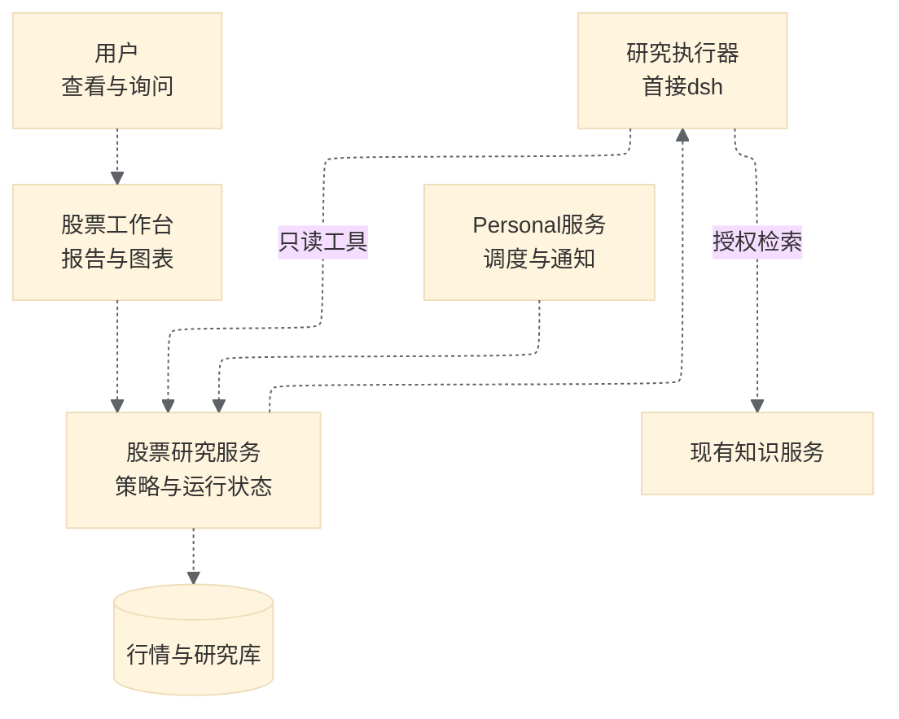

# 多策略股票研究系统实施计划

日期为2026-11-23。本文保存已确认的实施计划；数据、量化、执行账本、完整真实互评及本机API已实现，Agent面板已接线且页面操作待登录验证。固定股票查询与三项只读CLI/MCP也已接通；持续名单的终态跟踪、HTTP/CLI与Agent面板，以及固定报告个股事实/行情图也已接通；参数版本与CAS发布已接后台、API/CLI消费和Agent维护界面；未建run的输入准备回执也已接HTTP/CLI和Agent；固定报告的市场、分组、比较和规则查询已接HTTP及独立研究MCP；固定报告研究问答已接独立模型循环、持久父链与Agent界面，整池搜索/分页已接HTTP、绑定工具与个股区；主题/自选维护已接人工确认、版本消费与Agent；Personal三项只读查询已接本机DSH预设；页面操作、Mac mini正式部署及定时任务仍待验收，以第16节及交接文档检查点为准。用户已确认首版方向，本文将工程默认值作为可审阅的研究基线。

## 1 目标与成功标准

在独立股票工作台中运行Wyckoff和Martin两套美股选股策略。每套策略独立计算、复核并选出最多5只股票，随后对另一套策略选中的股票发表有数据依据的意见。每天美股开盘前60分钟提供盘前研究报告，通过现有Personal服务发送飞书通知。

系统保存股票池、行业与主题版本、行情快照、因子定义、规则参数、模型及提示词版本、初选、交叉评议和后续表现。更换交互Agent时通过既有接口继续访问这些状态。首版验收关注数据正确性、策略依据、过程复现和后台运行，再积累实际选股效果。

首版应实际完成以下用户路径。

1. 定时任务主动检查并补齐行情，按同一截止日期完成两个策略的选股。
2. 用户打开工作台，分别看到两套最多5只的重点名单、入选依据和对方观点。
3. 同一股票被多套策略选中时，能同时查看各自理由，原始名单分别保留。
4. 用户追问某只股票或某份报告，Agent调用只读研究工具回答并引用实际证据。
5. 局部任务失败时可查看已完成部分、失败原因和重试进度，重试保持已成功产物。
6. 更换Personal交互入口后，仍能查询同一报告、候选和事实版本。

## 2 已确认的产品决定

| 项目 | 决定 |
|---|---|
| 市场 | 美股先行 |
| 股票池 | 标普500与纳斯达克100成分股去重，加人工自选股 |
| 策略 | Wyckoff与Martin分别选股，支持后续注册新策略 |
| Martin范围 | 刚转强后的早期回调、已有上升趋势中的回调 |
| 数据 | 完整日线OHLCV、公司资料、行业及主题分类 |
| 板块 | 细分行业为基础，主题表人工确认，Agent提议变更 |
| 判断方式 | 程序形成量化合格池，模型在池内查证、排除、排序和选择 |
| 重点名单 | 每策略最多5只，允许少选和空集合 |
| 交叉评议 | 独立初选保存后互评，保留当天原名单 |
| 名单管理 | 每天维护新增、等待、接近观察区、失效及数据不足状态 |
| 交互 | 专用股票工作台，保留查询、解释与重新分析入口 |
| 重分析 | 单独生成新记录，可与原报告对照 |
| 运行 | 另一台24小时Mac mini，通过Tailscale连接 |
| 完成时间 | 每个美股交易日开盘前60分钟 |
| 通知 | 成功和失败都复用现有飞书渠道 |
| 验收 | 先查判断过程与教程一致性，再积累后续表现 |

首版的信息范围决定了盘前报告以日线观察区、待确认动作和失效参考为主。分钟触发验证、真实成交回测、自动下单、实时盘前事件和新闻筛选属于后续能力，须有对应数据与独立规格。

## 3 规划时核验的代码基线

本表保存规划时记录，续接实现与本机实际版本以第16节及交接文档的最新检查点为准。

| 对象 | 已核验状态 | 实施影响 |
|---|---|---|
| 当前工作区 | 位于codex/cn-prewarm-timeout，有行情、测试及教程等未提交改动 | 从现有状态提取明确清单，逐项保留用户改动 |
| 本地main | 已快进到上游22dc8c65 | 以该提交作为新股票应用的上游基线 |
| 上游产品 | React、CLI、MCP，支持多市场，Streamlit已退出main | 新工作台沿用React技术和可复用图表组件 |
| 上游行情 | 主要在线链路依赖TickFlow，业务存储使用Supabase等既有机制 | 本次增加已有数据库行情适配，保持计算与取数分离 |
| 当前Martin | core/martin_luk.py，日线研究v1 | 复用已验证的公式，拆出参数、来源和阶段条件 |
| 当前行情 | 云端PostgreSQL增量同步到本地SQLite | 继续复用同步、隔离和水位逻辑 |
| 本地美股库抽样 | 520只股票，覆盖日期到2026-11-20 | 重新核对成分来源，不能直接以数量证明股票池完整 |
| Personal服务 | services@680a67a，personal-agent-handoff分支 | 作为任务、通知、知识及接手约定的依据 |
| Personal执行 | 既有direct调度、固定argv运行、运行与投递回执 | 股票任务登记到同一执行体系 |
| 本机dsh | 已安装0.2.2-rc.1，支持独立home、profile与运行入口 | Mac mini安装版本与接口仍须现场核验 |
| AKQuant | 已查官方文档及声明，参考版本0.3.93 | 实施时固定版本、检查依赖并实测，当前尚未安装验证 |

Personal服务的指定提交以代码及其验收记录为证据。本机DSH Personal三项查询已读回确认；正式Mac运行包、访问入口和调度权限仍分别验收。main同步不代表当前工作分支、远端fork或生产环境已经完成上游升级。

## 4 总体边界

股票领域能力拥有行情处理、策略计算、选股、交叉评议、报告和观察名单。Personal服务拥有已有调度、任务回执、通知渠道和个人状态。知识资料通过已有知识服务按授权检索。dsh作为首个研究执行器，使用结构化工具与结果约定接入。

股票应用新增一个本地研究API进程，提供领域接口并承载编排。React静态资源由该进程服务，工作台与API同源。已有Personal网关、知识宿主和行情更新流程分别沿既有入口连接。涉及Wyckoff仓库和services仓库，预计修改超过8个文件。

虚线表示本计划中的接续关系。图中现有服务的内部实现以各仓库既有契约为准。

### 4.1 独立运行与复用

股票应用使用独立配置、日志、模型会话、研究工作目录和数据库schema。dsh适配器配置独立DSH_HOME及DSH_AGENTS_HOME，避免策略会话加载其他系统的隐式状态。模型接入可引用既有可信配置，由运行进程读取。

工作台通过现有Tailscale身份代理访问。研究API直连仅绑定loopback，自动任务使用独立服务身份，浏览器使用同源会话。写接口校验操作者与请求来源。研究工具按workspace、run和snapshot限定范围，查询历史时统一截断到快照截止日。

同一股票系统中的策略共享行情快照和基础因子，各自维护筛选规则、模型会话、候选与评议。Personal交互Agent只经授权接口读取股票状态；股票报告的持久事实保存在股票领域存储。可将经确认的报告及教材登记到知识服务，登记与可检索状态分别记录。

### 4.2 技术选择

| 部分 | 首版选择 |
|---|---|
| 领域计算 | Python3.12，复用现有pandas/NumPy和上游Wyckoff计算 |
| 研究工具 | AKQuant固定0.3.93，先核对输出一致性，再使用批量因子与回放能力 |
| 研究API | FastAPI、Pydantic v2、SQLAlchemy2 async、asyncpg |
| 前端 | 复用上游React/TypeScript及图表组件，沿用web锁文件与包管理版本 |
| 研究状态 | 现有PostgreSQL实例中的独立stock_research schema |
| 行情读取 | 已有SQLite只读快照及云端PostgreSQL同步流程 |
| 研究执行 | 独立dsh适配器，提供可替换的执行接口 |
| 调度与通知 | services现有direct任务与飞书投递机制 |
| 部署 | Mac mini原生进程与launchd，Tailscale访问 |

计算密集的同步库在受控工作进程执行，Web请求通过异步任务接口读取进展。采用uv与uv.lock，前端沿用现有锁文件。AKQuant核心库优先走Python接口，其官方MCP扩展与上游MCP依赖的大版本分别管理。

## 5 行情与股票池

### 5.1 股票池构建

建立版本化成分清单，记录来源、指数、股票代码、公司名、生效日期、失效日期、取得时间和内容摘要。标普500与纳斯达克100按规范化symbol去重，保留多重成员关系，再叠加人工观察股。兼容点号、连字符及供应商代码差异。

当前520只的来源重新核验。已有标普快照含515只且本地另有5只，不能直接作为两个指数并集。新增纳斯达克100成分的获取、校验和同步入口，保存每期成员快照。退选成分停止进入当前股票池，已有研究和历史行情继续可查。

自选股在工作台管理，记录加入来源与时间。聊天入口保持已确认的查询和重分析能力。历史研究使用当时可获得的股票池；缺少历史成分时标注当前池回溯样本的存活偏差。

### 5.2 行情与基准

统一日线数据契约包含symbol、market、session_date、open、high、low、close、volume、adjustment、source、source_revision和observed_time。原始成交金额、未复权价格等字段有来源时另行保存。沿用已有复权口径，入库校验价格、单位与拆股修订。

基准使用SPY、QQQ和IWM，分别服务市场概览及策略相对表现。指数基金与同名股票使用不同kind。交易日按America/New_York的正式交易所日历解析，存储操作时间与日志使用带Asia/Shanghai时区的时间。日线session_date保留美股交易日含义。

优先执行云端已有日更及必要补齐，再增量同步到Mac mini。若云端尚未更新，研究任务调用已经登记的行情更新入口。建立按市场与目标日期的任务锁，避免与Actions或其他更新同时写入。同步完成后重新检查水位与目标交易日，按修订时间覆盖历史变更。

### 5.3 数据质量默认条件

以下为首版工程默认值，配置和报告均保存版本。

| 条件 | 默认处理 |
|---|---|
| 必要基准缺少最近完整交易日 | 更新及重试后仍缺失，本日研究失败 |
| 当前股票池日期对齐覆盖率 | 至少95%，低于门槛时整体数据阶段失败 |
| 已确认停牌 | 分别列示，覆盖率分母中明确扣除，保留证据 |
| 缺数、未确认停牌 | 计入覆盖率失败项 |
| Martin历史长度 | 至少100根有效日线 |
| Wyckoff历史长度 | 采用上游美股配置的320根窗口，长度不足单独排除 |
| 异常OHLCV、日期重复、单位或复权冲突 | 隔离并显示原因，修复后重算 |
| 个股少量缺失 | 排除该股票，报告列明；已有观察股转为数据不足 |
| 缺行业分类 | 列入资料待完善，当前量化池排除 |
| 缺可用主题 | 继续使用行业分析，显示主题未分配 |

每次运行绑定不可变数据快照，包含读取范围、数据版本、摘要和质量清单。同步与分析并发时，分析使用事务一致的备份或物化文件，避免指标计算过程中混入新行。

### 5.4 公司、行业和主题

复用上游integrations/sector_map_yfinance.py和已有分类缓存的可用逻辑，形成带取得日期的公司资料。初始主题表基于确认过的公司业务归组。Agent只能提交主题变更建议，人工在工作台确认后发布新版本。

主题成员、来源、确认时间和版本完整保存。报告引用当次生效版本。历史评估缺少当时分类时明确标注，避免将后来题材信息写回过去。

## 6 因子与参数基线

出处以[因子核对清单](docs/martin_luk_factor_provenance_2026-11-23.md)为依据。因子描述、算法和阈值分别记录证据。下列数值是首版研究默认值，尚未通过参数优化或收益验证。

### 6.1 共享因子

| 因子 | 首版定义 | 可调内容 |
|---|---|---|
| EMA | 9、21、50根日线，沿用现有adjust=False计算 | 周期、预热方式与算法版本 |
| ATR | 真实波幅最近14根简单平均 | 是否启用、窗口、平滑算法 |
| ADR | 最近20根平均(high/low−1)×100 | 公式、窗口、阈值及条件开关 |
| 收益与相对强度 | 1、3、5、20、60根收益；20根相对SPY收益差为基线 | 窗口、基准、分组内排名 |
| 量能 | 3根平均量对之前10根平均量，补充20根均量 | 窗口及比例 |
| 流动性 | 优先采用有来源的成交金额及20根平均 | 来源、窗口与门槛 |
| 收紧 | 3根平均高低区间对前10根均区间 | 窗口、比例及用途 |
| 支撑距离 | 日低与EMA9/21或已确认平台沿的距离，以ATR归一化 | 支撑类型、距离尺度和带宽 |
| 延伸 | (close−EMA21)/ATR14 | 尺度、均线与门槛 |
| 结构 | 确认的突破、摆动高低点、首次回测和上方阻力 | 识别窗口、确认规则与容忍带 |

行情库缺少真实成交金额时，可提供close×volume的计算代理并标注口径，用于观察或排序。复权价格与成交量无法确认一致时该项标记缺失。该代理不自动替代原始成交金额硬门槛。

行业与主题每天计算20根等权超额收益中位数、近1/3根上涨成员占比和趋势健康成员占比。有效成员至少3只、行情覆盖率至少80%才形成分组得分；成员较少的主题展示成员证据。首版分组得分采用三项截面分位数等权平均，用于排序。已有Wyckoff板块规则单独保留其原定义。

### 6.2 Martin成熟趋势回调

沿用旧模块形成明确基线。

1. EMA9>EMA21>EMA50，各线高于5根前，收盘不低于EMA21。
2. 当前收盘低于此前5根最高收盘，或当前低点下移且收盘低于前日高点。
3. 日低距EMA9或EMA21不超过0.75倍ATR，且收盘守在对应线上。
4. 距EMA21超过3倍ATR作为默认排除条件。
5. 近3根均幅不高于此前10根的70%，且均量不高于此前10根，作为收紧加分项。

每条条件包含启用、阈值、作用方式和来源字段。收紧加分与完整趋势门槛分别配置。相对强弱和板块得分参与排名，首版不增加未验证的固定收益率硬门槛。

### 6.3 Martin早期转强回调

此分支补足旧模块覆盖不足的早期机会，以下算法明确标为工程研究定义。

1. 在最近20根中寻找收盘突破其之前60根最高价的事件，事件参考只用当时已经完成的数据。
2. 取最近一次符合条件的突破，固定其平台上沿及日期；突破后至少经过一根完整日线。
3. 当前价格较突破以来最高收盘回落，日低进入平台上沿或向上EMA9/21的0.75倍ATR观察带，收盘收回所选支撑之上。
4. 突破后若已有日线收盘低于平台上沿减0.75倍ATR，结束该次首次回测观察，等待新结构。
5. 首次回测以突破后第一次进入所选观察带为事件；其后仍在同一带内的连续日线归为同次回测，离开观察带后再次回到按重复回测标记。
6. 距EMA21超过3倍ATR默认排除。该分支保留均线排列事实，独立使用转强结构条件。

两个分支对同一股票同时命中时保留全部标签，Martin名单按symbol去重。突破窗口、回测观察期、支撑带、均线方向和失效规则均配置化。

### 6.4 支撑与锚定均价

每个候选保存所有支撑候选、采用理由和距离，默认优先选择当前收盘下方且最近的有效支撑，距离相同按平台沿、EMA21、EMA9排序。日线反转高点与结构低点展示为观察参考，说明所用K线和日期。

锚定均价以突破事件日及已确认摆动高低点为锚点。摆动点采用左3根、右3根确认，锚点须在截止日之前已完成确认；搜索窗口60根。使用日线典型价格(H+L+C)/3及同口径成交量计算加权均价，标记为日线估算。首版只提供辅助证据，硬过滤默认关闭。锚点、估算公式和确认窗口保留配置。

### 6.5 Wyckoff基线

复用本分支core/wyckoff_engine.py、core/market_funnel_config.py及实际美股调用方workflows/market_funnel_job.py的漏斗、量价和诊断逻辑。实际美股任务的run_funnel_for_ranked通过_run_layers、_candidate_rows和_cap_candidates_for_regime组合L1～L4、排序与水温限制；研究适配使用相同组件，显式传入快照行情和SPY，不调用TickFlow取数或通用候选旁路。

默认配置由funnel_config_for_market('us')产生，保存完整FunnelConfig及其摘要。执行前确认上游配置档的加载优先级；研究覆盖项使用已有apply_funnel_config_overrides，未知字段报错。

候选优先取上游正式通过的美股集合和原有排序。额外旁路、观察池及防御市强制补位在首版独立列示，不用配额补足5只。结构名、量价规则、失效和目标参考保持上游语义，所有个股排除均列出层级、原因及缺失数据。

### 6.6 排序与模型合格池

Martin默认用可解释规则得分，归一化分位值在本次有效股票池上计算。

| 项目 | 默认权重 |
|---|---|
| 20根相对SPY强度 | 25% |
| 行业或已确认主题强度的较高值 | 20% |
| 与采用支撑的接近程度 | 20% |
| 结构或趋势完整性 | 15% |
| 量能改善 | 10% |
| 收紧程度 | 10% |

支撑接近度以1−min(归一化距离/带宽,1)计算，连续值线性映射并保存原值。结构完整性由对应分支必要条件与已确认结构证据生成。量能改善和收紧采用分位排名。辅助项缺失时标记缺失，并对可用权重重新归一化；必要条件缺失则排除。早期和成熟分支分别排名，按名次轮流合并，形成最多30只模型复核池。

Wyckoff使用上游通过条件和排序，最多30只进入复核池。模型可对池内股票调用工具补充证据、排除和排序，最终最多5只。返回池外symbol或与实际因子矛盾的数值时拒收并请求一次结构修正，仍失败则标记该阶段失败。候选池规模、权重和合并方式均为可调研究参数。

## 7 策略接口与执行器

每个策略注册名称、版本、配置schema、必需数据、计算入口、选股提示词和评议提示词。首版策略ID为martin和wyckoff。新增策略沿同一接口接入。

| 阶段 | 输入 | 输出 |
|---|---|---|
| compute | 快照、截止交易日、股票池、配置 | 全量因子、命中、排除原因、排序 |
| select | 本策略合格池、证据引用、工具范围 | 最多5只、理由、风险及待确认条件 |
| review | 目标股票、快照、本评议策略的事实 | 支持、质疑、证据不足、确认条件 |
| track | 已有名单与本次有效结果 | 状态变化及事件记录 |

研究执行器契约接受run_id、stage_id、strategy_id、角色、只读工具范围、输入摘要、模型与提示词版本、deadline，输出结构化结论、证据引用、调用记录、用量和失败原因。首个适配器使用当前dsh支持的SDK或受控结构化运行接口；实施时以安装版本的真实握手、工具调用和结果解析验收。

服务端工具限定为股票、分组、历史、因子、报告和知识查询。底层模型持有的连接配置由受信进程读取，工具以快照和workspace范围校验。策略会话与其他系统任务会话隔离，研究工具不提供任意SQL或任意文件操作入口。

首版沿用Mac mini已有可用模型接入；策略、选股与评议可分别配置模型。执行前冻结配置，运行中调整只影响下一次运行。单任务模型并发默认2；每阶段默认180秒、20次只读调用和一次可重试失败。正常工作量超限时记录预算中止，保留已完成产物，后续依据实际运行耗时调整。

## 8 独立初选与交叉评议

选股阶段各策略只看到共享事实及自身候选，独立生成结果。所有成功初选事务提交后，发布对应strategy_selection_id，后续评议引用该版本。

对每个成功初选集合，其余已注册策略分别发表观点。两策略首版形成Wyckoff→Martin名单和Martin→Wyckoff名单两批评议。不同策略选中同一股票时，展示双重入选事实，并保留两份理由。某策略自身选股失败但计算事实仍可用时，可独立尝试完成评议。

评议至少包含reviewer_strategy、target_strategy、symbol、target_selection_id、stance、evidence_refs、objections、confirmation_conditions和data_limitations。立场为support、concern、insufficient_evidence之一，每个实质观点关联因子、K线或分组证据。

保留初选，评议记录单独更新。首版不产生统一买入评分或合并强制名单。新增N个策略后保持各自最多5只，交叉评议按N×(N−1)方向调度，批处理同一评议者对同一名单的内容，共享只读因子缓存。

数值计算以相同快照、算法及配置复现。模型原始输出和工具事件完整留存，用于回放当时判断；重新调用模型产生新分析版本，记录结果变化。

## 9 状态存储与幂等

新增stock_research schema，使用SQLAlchemy2 async访问。新实体标识为UUID4；API使用UUID，界面展示如SR-20261123-US-001的业务单号。新表采用复数命名、create_time/update_time/delete_time及is_deleted约定。日期字段区分目标交易日、数据截止交易日和带时区操作时间。

| 表 | 主要内容 |
|---|---|
| universes、universe_members | 成分、自选及生效版本 |
| classification_versions、group_members | 行业主题来源、确认及版本 |
| strategy_versions、parameter_sets | 因子、规则、模型、提示词及出处 |
| market_snapshots | 行情范围、版本、质量和内容摘要 |
| research_runs、stage_runs | 定时或重分析运行、阶段、截止时间和错误 |
| factor_results | 快照与算法版本下的值、命中、得分及缺失 |
| strategy_selections、selection_items | 不可变初选版本及条目 |
| cross_reviews | 目标初选版本及交叉评议 |
| watchlist_items、watchlist_events | 当前观察状态及变化原因 |
| research_reports、report_revisions | 运行报告及渐进补齐版本 |
| delivery_references | 引用services投递回执及业务摘要 |
| evaluation_results | 观测窗口、后续表现及样本限制 |

自动运行幂等键使用workspace、market、目标交易日、配置版本及trigger_kind的规范化摘要。每个策略阶段另有稳定stage_key。强制重分析创建新运行并关联parent_run_id。数据库唯一约束及事务领取任务，保证并发启动时只有一个执行者。

指标与初选在其阶段完整计算后原子提交。模型超时只重试对应阶段。交叉评议和通知补齐不重做已成功初选。进程重启时根据阶段回执、快照和产物摘要恢复；未知投递状态通过services回查。

观察名单按策略分别管理。新入选且此前未活动的股票记为新增；结构仍合格但未进入当日最多5只的股票继续等待；进入本策略有效支撑带记为接近观察区；有数据且硬性结构条件失效时记为失效，并注明具体条件。缺行情、缺模型结论或阶段失败时保留上一有效状态，另加数据不足或本日未复核标记。新条件与旧状态同一事务保存，按交易日、策略、symbol和事件类型去重。

新建库对象用独立DDL交付，在隔离PostgreSQL验证，再按生产维护流程执行增量变更。回滚保留研究数据，旧schema与业务源继续可读。

## 10 每日执行与异常恢复

工程调度默认在纽约时间08:00发起。最近已完成交易日通常为前一交易日，由日历计算；目标日指本次即将开盘的交易日。计划完成期限为正式开盘时间减60分钟。节假日记录跳过，半日市按实际开盘与收盘计算。

1. services以direct运行stock-research-premarket固定workflow。
2. 程序检查交易日、当次幂等键、配置和股票池版本。
3. 更新必要行情，增量同步并复核质量；失败使用60秒和180秒两次退避重试。
4. 固定快照，计算共享事实及两策略独立量化池。
5. 两个独立选股阶段并行运行，分别提交成功初选。
6. 对成功名单执行交叉评议，渐进补齐报告。
7. 到开盘前60分钟发布当前报告状态并请求飞书通知。
8. 局部失败继续有界重试至纽约08:50，补齐后发布新报告修订与恢复通知。
9. 保持失败或未知的部分留下回执和可重跑入口，结束当次程序。

[固定盘前入口](docs/stock_research_premarket.md)已接原计划上下文、无副作用plan，以及专用有限API身份的实际受理/等待/局部恢复/取消；隔离原生PG和真实HTTP链路已读回固定报告。延迟事件保留原目标日和期限，生产自动计划、行情刷新及通知仍未启用。跨新手动事件的配置去重与强制补跑parent链仍需对齐第9节。

固定workflow总超时3300秒，内部执行截止3000秒。各模型阶段、行情请求及重试须服从剩余预算，取消后回收子进程并确认终止。网络中断后已经越过正常生成期限的补跑只生成标明迟到的研究，不伪装按时完成。

| 失败位置 | 行为 |
|---|---|
| 基准或整体覆盖不达标 | 当日数据阶段失败，保留历史报告和名单 |
| 少数个股缺数 | 排除并列明；观察状态保留为数据不足 |
| 某策略量化失败 | 对应策略失败，其余策略继续 |
| 某策略模型复核失败 | 保留其量化候选及错误，不将候选冒充正式初选 |
| 某项互评失败 | 已完成初选可查看，评议显示待补齐 |
| dsh或模型不可用 | 研究状态与已完成事实保留，接口显示执行器错误 |
| 飞书发送失败 | 通过services稳定业务键重试，成功与发送分别显示 |
| 发送结果未知 | 回查既有回执，进入unknown状态处理 |

运行状态采用pending、running、completed、partial、failed、cancelled。services自己的run状态保持原契约；其completed表示程序完成，股票结果的partial等放在结构化output中，前端分别展示。阶段状态、报告完整性和delivery状态分别记录。

## 11 Personal services接入

新增工作流名stock-research-premarket及单次运行所需的显式能力映射。沿services@680a67a的固定argv约定接入，动作只传workflow名和结构化input，实际可执行程序、工作目录和超时由operator注册表持有。

固定入口采用股票API客户端。它读取自己的配置文件，向本地股票研究API启动任务并等待对应回执。研究API持有自身行情与数据库配置；workflow无需继承网关的数据库和服务端凭据。

股票系统在目标报告期限将摘要和报告引用交给services既有投递适配器，由后者负责投递与去重。服务注册前核对该适配器的真实公开边界；若当前仅供内部Python调用，增加一个限定股票报告类型的内部调用入口并同步契约与测试。原有Bot与目标从部署配置引用。

services配置按仓库要求对齐workflows.json、部署身份能力、external映射、Policy路由、cron.json及名称一致性。direct执行权由cron登记，platform映射用于交互查询或显式触发，同一日自动计划只有一个调度所有者。新增计划沿既有注册、同步和回执流程实施。

飞书首条通知包含目标交易日、实际行情日期、各策略入选数量、评议完成度、数据排除数及工作台链接。恢复通知只针对状态改善发送，内容哈希与报告修订共同去重。通知预览使用隔离目标或无发送模式，正式投递保留原目标与可核验回执。

Personal工具接入提供查询最新报告、查询股票观点及查询运行状态三项只读能力，沿已有MCP/CLI/HTTP方式发布。现已接本机DSH Personal预设的独立stocks MCP，原工具与个人权限保持；预设运行读取与独立DSH实际四项读取通过，零模型轮数。配置安装/精确撤回见[Personal接入](docs/stock_research_personal.md)；该进度不包含workflow、cron、通知或正式Mac部署。既有personal_quotes仍服务其持仓范围。股票研究的完整池查询通过股票工具完成。

## 12 API与工具契约

研究API使用/v1前缀和Pydantic显式输入输出。所有响应含code、message、data、correlation_id；成功code为0000。异步任务启动返回202，参数错误422，鉴权错误401/403，状态冲突409，来源不可用503。

| 接口 | 用途 |
|---|---|
| GET /healthz、/readyz | 进程与依赖就绪状态 |
| POST /v1/research-runs | 按目标日期和配置启动，支持Idempotency-Key |
| GET /v1/research-runs | 分页查询运行 |
| GET /v1/research-runs/{run_id} | 阶段状态、数据质量及错误 |
| GET /v1/research-runs/{run_id}/events | SSE进展及断线续读 |
| POST /v1/research-runs/{run_id}/retry | 选择失败阶段重试 |
| POST /v1/research-runs/{run_id}/cancel | 取消未完成阶段 |
| GET /v1/reports/{id}/universe | 全部冻结有效成员、字面搜索与SQL分页，保留缺行情/分类状态 |
| GET /v1/reports/latest | 指定市场及目标交易日的最新报告 |
| GET /v1/reports/{report_id} | 固定修订、初选及互评 |
| GET /v1/stocks/{symbol}/observations | 指定快照的事实和策略观察 |
| GET /v1/watchlists | 分策略查询持续名单 |
| GET /v1/strategies | 已注册策略与当前版本 |
| GET、POST /v1/parameter-sets | 查询与创建参数版本 |
| POST /v1/strategies/{strategy_id}/activate-parameters | 按expected_revision激活参数版本 |
| GET、POST /v1/theme-proposals | 查询及提交分组建议 |
| POST /v1/theme-proposals/{proposal_id}/confirm | 按expected_revision确认 |
| GET、POST /v1/universe-overrides | 查询与维护人工自选 |
| POST、GET /v1/chat-turns | report_id固定的私有研究对话、SQL分页历史；parent_turn_id续接CAS |
| GET /v1/chat-turns/{id}、POST /v1/chat-turns/{id}/cancel | 独立问答状态与收尾取消 |
| POST /v1/evaluations | 启动有版本的历史选股评估 |

对报告初选不提供覆盖接口。参数集创建后不可变，发布新版本采用expected_revision防止并发覆盖。分页排序字段使用白名单，并提供稳定的次级排序。

Agent只读工具为market_overview、group_strength、stock_factors、stock_history、compare_stocks、strategy_rules、report_read、run_status，以及已授权的knowledge_search。重分析属于工作台后端显式动作，创建新run并留档；聊天默认不获得参数、主题和自选维护工具。

## 13 工作台

首页默认打开最近一个目标美股交易日，显著显示实际行情日期、报告完整性、最近成功时间与通知状态。策略区分别展示最多5只，默认不将不同策略合并排序。交叉评议与本策略入选理由分别呈现。

| 页面 | 必备内容 |
|---|---|
| 今日计划 | 市场、行业主题、分策略初选、交叉观点、局部失败 |
| 个股详情 | K线、均线、支撑区、量价事实、分策略观点及证据定位 |
| 观察名单 | 新增、等待、接近观察区、失效、数据不足与变化事件 |
| 历史报告 | 目标日、策略和修订查询，初选与后续互评可对照 |
| 研究参数 | 来源标签、算法、阈值、条件开关和配置版本 |
| 分组与自选 | 公司资料、主题建议、人工确认与自选维护 |
| 运行中心 | 更新、计算、选股、互评、发布及通知回执 |
| 实验结果 | 参数组合、样本时间、覆盖、后续表现及限制 |

聊天入口继承当前报告/股票上下文，回答显示证据与数据日期。重分析通过显式操作进入新记录，原报告继续可查。界面用公司名称和股票代码展示标的，内部UUID只用于路由。

## 14 验证与AKQuant实验

### 14.1 因子与量化逻辑

使用固定OHLCV样本检验EMA初始化、ATR简单平均、ADR、交易日对齐、除零、停牌、缺失、拆股修订与支撑选择。AKQuant输出逐值与参考公式对拍，记录误差容忍值及算法差异；ATR与EMA在未完成一致性验证前保留参考计算路径。

选股回放按历史截止日切片。因子、分组和模型工具统一拒绝读取截止日之后的信息。摆动点验证确认时点。Wyckoff直接调用正式生产算法，使用上游已有黄金样本及实际美股数据验证适配前后的层级结果。

### 14.2 多策略与失败恢复

验证两策略各0～5只、重复股票双重归属、互评引用、池外输出拒收、模型无证据结论拒收、失败阶段重试、初选不可变、手动重分析留档、重启恢复与同日并发幂等。使用真实隔离PostgreSQL验证事务、唯一约束和状态恢复。

测试包含数据阶段失败、单股排除、模型限额、超时取消、断线重连及通知unknown。自动测试按仓库约定隔离网络，真实接口探测与飞书无发送预览作为单独验收命令记录。

### 14.3 历史研究与参数实验

选择20个可获得完整行情的历史截面，按SPY的20根收益排序等距抽取，覆盖相对较强、中等和较弱环境；记录抽样方法。只有具备当时数据版本的截面可称严格时点回放，使用当前修订历史和当前成分时明确标注限制。

首轮人工审查每策略至少10个入选和10个排除样本，查看是否符合教程与实际代码。后续按入选后1、3、5、10、20个交易日记录收益、相对SPY表现、最大有利和不利变化。该类选股观测与完整交易回测分别标注。

初次参数实验采用按时间顺序的60%研究、20%验证、20%封存检验划分，样本不足时只记录描述性结果。先分别研究支撑带0.5/0.75/1.0倍ATR、延伸2/3/4倍ATR、收缩比例0.6/0.7/0.8三个参数组，其他参数固定；确认单组结果后再做有限组合。EMA周期和因子定义改变均生成新算法版本。

后续收益只在对应观察窗口已完整结束时计算，尚未结束记为pending。固定截止日的离线评估为20日窗口预留完整后续行情。训练、验证及封存分界按最长观察窗口清除重叠样本，避免收益标签跨边界泄漏。

AKQuant承担批量计算与历史实验。用同一股票池、历史区间和输出字段比较现有实现与AKQuant的冷启动、热运行、总耗时和峰值内存。记录结果一致性及转换开销，按实测选择生产计算路径。收益门槛不作为首版上线承诺。

### 14.4 验证命令

实施后新增命令统一由python3.12或项目虚拟环境运行，并写入包入口与文档。

| 命令 | 必须验证的内容 |
|---|---|
| python3.12 -m stock_research.cli doctor | 配置、依赖、时区、日历、数据库与服务就绪，输出脱敏 |
| python3.12 -m stock_research.cli snapshot --market us --as-of 2026-11-20 | 固定数据快照、覆盖与摘要 |
| python3.12 -m stock_research.cli analyze --market us --as-of 2026-11-20 --strategy martin --no-llm | Martin量化池及排除证据 |
| python3.12 -m stock_research.cli analyze --market us --as-of 2026-11-20 --strategy wyckoff --no-llm | Wyckoff适配与上游结果一致性 |
| python3.12 -m stock_research.cli run --market us --target-session 2026-11-23 --preview | 完整流程与通知预览，无正式发送 |
| python3.12 -m stock_research.cli evaluate --profile baseline-v1 --cutoff 2026-11-20 | 版本化截面评估及样本限制 |
| python3.12 -m stock_research.cli benchmark --profile baseline-v1 --as-of 2026-11-20 --snapshot-file "$SNAPSHOT_FILE" | 同快照ATR/ADR逐值对拍与计算耗时；不代表完整策略性能 |

doctor、snapshot、Martin/Wyckoff的analyze及ATR/ADR的benchmark已实现并实际运行；run已完成真实四阶段预览及独立重读；evaluate仍为后续验收目标。已实现命令与限制以[数据CLI](docs/stock_research_data_cli.md)、[Martin CLI](docs/stock_research_martin_cli.md)、[Wyckoff CLI](docs/stock_research_wyckoff_cli.md)为准。开发验收同时运行上游AGENTS规定的pytest、ruff、quality_gate、工作流及依赖检查，前端运行构建、类型检查和相关测试；services运行其既有完整检查及受影响的契约测试。

## 15 文件与跨仓库工作清单

实际拆分遵循模块职责和既有规则，避免复制上游算法。预计改动范围如下。

| 仓库与路径 | 工作内容 |
|---|---|
| Wyckoff pyproject.toml、uv.lock | 研究依赖、Python入口与锁定 |
| stock_research/config.py、models.py | 版本配置、明确输入输出与状态 |
| stock_research/data.py、factors.py、groups.py | 快照、指标及行业主题 |
| stock_research/strategies/base.py、martin.py、wyckoff.py | 统一策略接口及实际调用 |
| stock_research/executor.py、pipeline.py | dsh适配、阶段执行与幂等恢复 |
| stock_research/store.py、api.py、cli.py | 数据持久化、HTTP和命令入口 |
| config/research/ | baseline-v1参数与分组版本定义 |
| docs/migrations/ | 新schema增量DDL及回滚说明 |
| tests/stock_research/ | 计算、契约、策略、恢复与集成验证 |
| web/apps/web/src/ | 复用图表，在既有Agent内增加研究子视图及API客户端 |
| integrations/local_market_store.py及相关同步模块 | 有选择迁移当前分支的数据逻辑 |
| scripts/与部署配置 | 本地检查、服务启动、健康检查和安装入口 |
| services actions/与已有运行/投递模块 | 固定任务入口、报告通知及运行产物适配 |
| services docs/api/及tests/ | 股票能力契约、去重、权限和通知验收 |
| services operator配置 | 新计划和能力注册，部署正本与仓库副本一致 |
| platform | 仅在现有工具注册契约需要时添加股票只读入口 |

教学素材保留当前文件与引用。新main上的应用遵循其React与CLI方向，研究文档和纯数据逻辑分别迁移。未提交内容先生成受保护备份和逐项文件摘要，再在独立工作树中导入相关改动。

## 16 实施顺序与每阶段可用结果

### 阶段一 数据与股票池

从main@22dc8c65建立独立开发工作树，提取现有行情同步与异常隔离模块，完成指数并集、分类版本、基准补齐、快照及质量命令。建立研究schema、配置与只读数据接口。

交付可查询、可复现的美股数据与质量报告。验收包括320根窗口可用性、缺数处理、历史修订、快照一致性及更新并发。该阶段可独立用于人工研究和后续策略计算。

2026-11-23续接进度：数据CLI已接通版本构建/导入、只读云端增量同步、SQLite一致备份、连续100/320根检查、三个独立基准映射、质量报告、文件物化及PostgreSQL事务存取。本机独立研究库已初始化，真实行情快照已提交并独立重读，隔离PostgreSQL测试已运行；DDL由Python schema导出。新同步入口使用事务级云端协作锁。该进度不是阶段一总体验收：正式指数来源更新、QQQ/IWM云端数据补齐、WBD源异常及旧更新入口参与互斥仍待完成。详见[数据CLI与本机配置](docs/stock_research_data_cli.md)。

后续数据批已接通按Git提交固定的公开聚合成分（非指数提供方认证）和单独保存的yfinance三基准补充。SPY逐值对拍通过，未改写云端或伪装出处。真实快照覆盖96.72%、三基准各320根，达到当前数据门槛，所有排除和当前池回溯限制保留。源码维护和数据使用以[公开数据说明](docs/stock_research_public_data.md)为准；官方历史成分、原云端缺口、旧更新入口协调及独立总体验收仍不宣称完成。

### 阶段二 Martin量化候选

实现共享因子、两类回调、出处标签、可调参数、得分及合格池CLI。接入AKQuant可比较的因子与benchmark入口。

交付可独立运行的Martin量化观察报告。验收包括早期转强覆盖、旧公式对拍、条件开关与历史截止限制。

2026-11-23实施进度：共享因子、双分支、可调规则及出处、行业事实、截面评分、确定性去重和不可变量化产物已接通CLI。旧模块实际输出保存数值黄金夹具；AKQuant仅对齐ATR/ADR，EMA继续使用参考实现。真实固定快照已扫描491只、生成最多30只复核池，`model_selection`仍为null。当前报告为本地文件，因子/候选数据库表及运行状态机留到后续接入，不声称模型初选或收益有效性。细节见[Martin CLI](docs/stock_research_martin_cli.md)。

### 阶段三 双策略选股与互评

复用Wyckoff生产美股计算，接入首个dsh执行器，完成独立选股、交叉评议、证据校验、结构化持久化和阶段恢复。新增研究API与预览运行入口。

2026-11-23首批进度：Wyckoff量化入口已复用美股正式层计算、候选排序与水温限制，增加可选逐层诊断，参数、有效配置、源码和数值依赖版本绑定不可变报告。真实快照490只计算完成且空池，保留CRASH水温和数据限制。合成非空Spring与生产run_funnel_for_ranked逐字段对拍；模型执行、初选/互评事务、API及恢复仍未交付。本机DSH已找到 `~/tools/e2e/bin/dsh`，实测0.2.1-alpha.2，后续须按此版本核对隔离配置与受控工具接口。

交付可手动生成的双策略完整报告。验收两套各最多5只、空名单、分歧、重复入选、模型失败及初选不可变。

### 阶段四 工作台与查询

复用React图表和组件，完成今日计划、个股、观察名单、历史、参数与运行中心，接入聊天及重分析留档。发布股票只读查询工具。

交付可由用户日常查看与询问的独立工作台。验收真实入口、证据定位、旧报告复查和失败展示。

续接进度：[固定报告研究问答](docs/stock_research_chat.md)已接后台隔离DSH八工具、逐值证据校验、PG幂等/父链、HTTP与Agent问答历史。只读身份拒绝私有问答，问答与选股共用两席容量；临时provider/传输错误在原截止与工具总预算内至多重试一次，逐次状态和回执保留；未知执行、限流、结构/预算/清理失败不自动重试。[完整股票池浏览](docs/stock_research_universe.md)已接搜索/分页和逐策略状态，缺数成员保留。[主题确认与人工自选](docs/stock_research_input_maintenance.md)已接持久化、日期生效、API/CLI实际消费和Agent维护。已确认锚点叠加已接固定报告HTTP/CLI和Agent个股图表，沿原日期/参数验证且不重算结构；浏览器控件仍待正常登录，API/CLI run已接独立量化worker、按策略任务/尝试、局部继续与只补失败，Agent显示固定量化状态及独立尝试历史；行情协调与部署继续实施。

### 阶段五 Mac mini自动运行

核对部署环境，安装独立研究服务与dsh配置，接入services固定任务、调度和飞书回执。完成无发送预览后启用一条正式计划。首个自然交易日持续检查至报告和投递结果可核验。

交付开盘前自动产生的盘前报告。验收夏冬令时样例、节假日跳过、行情落后触发更新、重复派发、局部失败补齐与服务重启恢复。

### 阶段六 效果记录与研究迭代

完成历史截面人工审查、后续表现归档、单组参数实验和多策略对照。策略升级以新版本发布，报告保留当时参数。

交付可追踪选股质量与参数实验的研究台账。首版使用不依赖未来优化结果。

## 17 部署与接入前置核验

这些项目属于操作环境核验，由实施者读取实际配置和工具结果填写部署清单，设计本身采用前述确定边界。

| 项目 | 核验与处理 |
|---|---|
| Tailscale与SSH | 通过已授权设备清单和SSH连接确认目标Mac mini及用户，记录设备身份 |
| 运行版本 | 读取Mac mini现有services、platform及部署清单，对比680a67a和接口schema |
| dsh及模型 | 核对已安装版本、独立profile、真实SDK握手、只读工具调用和结构化结果 |
| PostgreSQL | 读取现有连接配置引用，确认研究schema的限定角色与隔离测试库 |
| 行情源 | 确认现有US更新任务、目标日期参数、限速及失败回执，必要时补独立入口 |
| 通知 | 复用原Bot与目标引用，验证预览和稳定业务键的去重路径 |
| 访问入口 | 研究API默认127.0.0.1:8788，端口占用直接报错；通过已有Tailscale代理配置增加独立入口 |
| 持久目录 | 在operator确认的应用数据根目录建立stocks独立子目录，日志、快照、报告和dsh状态分开 |
| 进程 | launchd托管研究API，校验退出后恢复、优雅停止及后台任务恢复 |

新增配置使用.env与Pydantic Settings，提供.env.example并确保.gitignore。股票数据库、模型、services调用和知识reader分别引用授权凭据。workflow的环境过滤以现有契约为准，受信本地入口只读取自己的配置。

Mac mini上已有任务与通知能力按既有资产登记。股票新增计划沿固定argv注册，不重复部署个人记忆、索引或飞书基础设施。上线前对照配置备份、文件摘要和服务状态，保留可撤回的新入口。

## 18 回滚与风险

回滚先停止新增股票计划和研究进程，保留数据、报告和回执。恢复本次operator配置备份，撤回新增Personal股票工具入口。已发送通知按回执保留，数据库增量对象保留可读。上游同步和研究应用使用独立提交范围，避免回滚时覆盖教程、行情与其他工作。

| 风险 | 控制与验收 |
|---|---|
| 上游与当前分支差异大 | 独立工作树逐项迁移，保留用户改动，按真实入口回归 |
| 免费数据不完整或复权混用 | 数据阶段门槛、修订摘要、隔离与可解释排除 |
| 当前历史长度与成分资料有限 | 报告明确样本与存活偏差，继续积累时点版本 |
| 日线无法还原盘中执行 | 选股观察与交易绩效分别验证，分钟执行增加相应数据 |
| 参数过拟合 | 分组实验、时间划分、封存样本和完整尝试记录 |
| 模型意见趋同或相互影响 | 独立选股会话、初选冻结及互评阶段边界 |
| dsh或模型故障 | 阶段回执、预算、局部交付和可替换执行接口 |
| services契约与部署版本漂移 | 接入前真实schema和能力探测，调用与回执分别验收 |
| 通知重复与发送未知 | 稳定业务键、复用去重及回查回执 |
| 新增策略导致互评量增加 | 合格池上限、分批评议、并发预算和事实缓存 |
| 库升级改变指标 | 固定版本、逐值对拍和算法版本化 |

最依赖现场核验的前提是Mac mini已部署服务能够按其记录的direct任务和通知契约接入。该项不满足时，先保留已可用的手动研究入口，修正接入适配后启用定时执行，研究数据和策略计算继续可用。

## 19 交付检查

- [ ] 完整股票池及分类有出处、版本与覆盖说明。
- [ ] 行情更新、快照和异常隔离通过真实入口验证。
- [ ] 因子定义与数值参数逐项可查看、可调整、可追溯。
- [x] Martin两类回调与Wyckoff正式算法均有样本验证（量化样本对拍，不是收益或执行验收）。
- [x] 各策略最多5只，量化池外输出被拒收（结构及范围验证，非收益或交易许可）。
- [x] 初选保存后互评，历史版本及不同意见完整可查（真实四阶段预览与HTTP/CLI独立重读；页面操作另验）。
- [ ] 名单变化、数据不足和失败恢复符合约定。
- [ ] 工作台与聊天入口都有生产调用链和真实操作验证。
- [ ] services任务、报告通知和Personal查询接线完成。
- [ ] Mac mini实际部署、Tailscale入口和自然交易日任务结果已核验。
- [ ] 参数实验与选股后续表现保留数据限制及样本范围。
- [ ] 交付说明分别列出修改、验证、提交和部署状态。

## 20 参考资料

- [因子出处与待测参数核对](docs/martin_luk_factor_provenance_2026-11-23.md)
- [来源分支Martin工作台规则](https://github.com/LanceJohnson45/Wyckoff-Analysis/blob/dc5fec0e9d675adf6e619240f1fc478d0b821420/docs/martin_luk_web.md)
- [Martin教程与资料入口](https://github.com/LanceJohnson45/Wyckoff-Analysis/blob/dc5fec0e9d675adf6e619240f1fc478d0b821420/research/martin_luk_final/README.md)
- [上游22dc8c65](https://github.com/YoungCan-Wang/Wyckoff-Analysis/tree/22dc8c65)
- [Personal接手基线680a67a](https://github.com/LanceJohnson45/dsh-superagent-services/tree/680a67ac88a73a30d345cb89f6e526a6d51b75a6)
- [Personal运行契约](https://github.com/LanceJohnson45/dsh-superagent-services/blob/680a67ac88a73a30d345cb89f6e526a6d51b75a6/docs/api/run-contract.md)
- [AKQuant因子引擎](https://akquant.akfamily.xyz/guide/factor/)
- [AKQuant参数优化](https://akquant.akfamily.xyz/guide/optimization/)
