# Martin Luk 回调买入法与其他交易方法：详细实操教程

> V4.1｜操作细节、第三方解说对照与收益口径修订｜2026-10-14<br>
> 阅读目标：不打开视频，也能理解每种方法的背景、准备、触发、止损、仓位、退出与失败处理。

## 先说明怎样使用本教程

这份教程以A～D四份Martin访谈/直播为主体，加入E：Financial Wisdom第三方解说的扫描框架和案例讨论，重排为完整学习过程。E片头标识为Financial Wisdom，属于博主整理，不是Martin新增亲述。先学共同准备，再练回调买入，然后读其他形态，最后用案例与练习检查自己。正文已解释交易逻辑；文末出处只是核对依据，无须一边看视频一边补内容。

为了让“详细”不变成伪造规则，文中采用四种标记：**视频经验**是Martin讲述或示范的做法；**教学步骤**是将其做法整理成容易执行、记录的顺序；**教学假设**是用于算仓位或演练的虚构数字，不是他的真实订单；**E博主归纳**是第三方重述或推测，单独标注并与本人素材对照。没有披露的参数会直接说明。

这里的分钟触发、盘中止损主要来自美股语境。若研究普通A股，第十四课说明需要改哪些执行环节。先用历史逐根回放或模拟记录练习；四份视频没有给出一套已经统计验证、人人通用的固定交易系统。

### 学习顺序与交付物

| 顺序 | 学什么 | 学完必须能独立写出的内容 |
|---|---|---|
| 1 | 第1～3课：共同基础 | 市场判断、候选理由、关键位、等待条件 |
| 2 | 第4～5课：回调两条入口 | 一张完整订单计划及取消条件 |
| 3 | 第6～10课：其他方法 | 能区分形态与触发，知道何时不用回调模板 |
| 4 | 第11～12课：仓位和持仓 | 算出股数、计划损失、部分退出后的实际R |
| 5 | 第13～15课：案例、适配、练习 | 解释失败原因、完成逐根回放与复盘 |


### 这次修订怎样使用

V4.0补回此前压缩掉的判断过程；V4.1进一步补三类扫描、名单迁移、仓位漂移和分批退出算例。**正文与案例承担教学，视频用于核对语气、鼠标指向与图表切换。** 每课的“操作拆解”解释具体看什么、下一步做什么、什么情况停止。请先通读第1～5课，再用第15课的逐根数据演练，不要只抄最后的入场按钮。

本教程将四种信息分开：**视频原意**是Martin在这四份素材中的讲解或自述；**教学解释/教学演练**是为使其做法可学习而补充的定义、顺序与虚构数据；**未披露**是现有素材无法确定的参数。后两者不能写回他的规则，也不等于经过回测的策略。**E博主归纳**是第三方对Martin做法的重述或推测，必须与本人讲解对照；有冲突时保留差异，不以下载先后判定版本新旧。来源A/B/C/D/E见附录。

**“可以实操”的含义：** 能照着搭图、列候选、等待、比较止损、计算数量、处理未成交、记录并逐根复盘。它不意味着四份视频已给出唯一机械交易系统。真实订单的类型、触发依据、有效时段和交易权限，应在自己的平台核对。第一轮使用回放或模拟；第14课单独说明普通A股无法照搬的地方。

新增截图保留原画面，不擅自在图上画“他的买点”。图下将说明图表代码、周期、要看哪一段、能证明什么；历史全图右侧的后续走势不是下单时可知的信息。**录屏中的讲解先后不必等于市场行情的时间先后。** 特别是QS的1分钟与5分钟示范切到了不同日期，不会拼成同一笔订单。

## 第1课：先决定今天应当怎样交易

### 1.1 看三个层面，而非只问“大盘涨不涨”

第一层看指数。视频常用QQQ、IWM：价格处在均线上方还是下方，均线是上升、走平还是下降，最近上涨/下跌是否顺畅，眼前是否就是前高、前低或周线关键位。此时只描述已发生的结构，不先预测下一根K线。

第二层看股票和板块。观察名单中的强股是否继续向上，突破是否很快失败，弱股是否反弹不过下降均线。指数上涨而大量成长股破位，意味着你交易的那部分市场可能很差；但只盯自己的弱股名单，也可能错过新领涨板块。

第三层看自己的交易。新仓入场后是否迅速走开？浮盈是否很快消失？是否反复止损后价格又回到原处？Martin把这种实际反馈看得很重。指数图看起来尚可，自己的入口却连续缺乏跟随，也需要降低参与程度。

**教学步骤：盘前写三句话。**

1. 指数：“趋势上行/下行/震荡，最近关键支撑为……，阻力为……。”
2. 板块：“较强的是……，较弱的是……；我的候选是否与板块一致？”
3. 自己：“最近新仓有跟随/缺乏跟随；今天维持、降低风险或暂时观察。”

三句话若互相矛盾，不急于强行选方向。保留多空候选、减少出手或持有现金，都是视频里真实出现的选择。**偏空观点不等于必须马上建立空仓；看见强股也不等于今天就有合适多头入口。**

### 1.2 用市场状态调整入口

| 当下观察 | Martin的经验如何理解 | 整理成什么动作 |
|---|---|---|
| 回调触及支撑后经常迅速向上 | 回调入口较容易产生跟随 | 重点准备支撑附近的反转触发 |
| 价格在支撑附近反复磨、不快速走开 | 原本有效的回调行为正在变差 | 少做同类回调，观察是否需要等整理后突破 |
| 开盘突破/跌破经常反转 | 最初一段价格噪声较多 | 降低开盘交易频率，等待新结构 |
| 个股和板块同步破位，反弹遇阻 | 趋势空头背景更清楚 | 研究反弹失败，而非追逐已经大跌的价格 |
| 多空均缺乏延续 | 不容易形成他偏好的波段 | 减少敞口，现金等待 |

首播中他在震荡环境倾向避开开盘最初15分钟，但也保留极好机会和开盘区间交易有效时的例外。另一期空头直播中，他不喜欢开盘最初15～30分钟追着下跌卖空。这不是全年固定禁令，也不能反推每笔都必须在某一分钟成交。

### 1.3 操作前先分清“形态”和“按钮”

回调、平台突破、U&R、下降趋势反弹、极端反转，是**为什么研究这笔交易**；突破前K高、跌破前K低、开盘区间突破，是**怎样触发订单**。

例如，一只强股回到日线EMA21附近，随后突破5分钟前K高：形态是回调买入，按钮是5分钟突破。另一个股票在大平台上沿突破，同样可以用5分钟按钮。不能仅因为两个订单都点在突破时，就将它们归成同一种策略。


### 操作拆解：盘前怎样得到一个可执行的参与决定

**视频原意（A市场反馈、C首播）：** 他并非先预测涨跌再找支持论据，而是同时看指数位置、领涨/落后名单迁移及新仓反馈。指数连续沿EMA9上行后已经延伸，和经过小平台或回到EMA9/21附近，是不同的进攻位置。与此同时，他承认自己有过“指数太高所以过早卖出甚至做空”的错误。延伸只能改变参与尺度，不能自动充当反向信号。

**实际操作顺序（教学整理）：**

1. 先打开QQQ、IWM的日线，再开所交易板块。写下最近已完成的摆动高低点，判断当前是靠近支撑、处在中间，还是临近阻力。不要仅凭红绿或涨跌幅判断。
2. 查看自己的持仓：哪些正向推进，哪些刚有浮盈就回吐，哪些入场后还停在成本附近。将“旧仓浮盈回吐”和“新入口连续失效”分开记，前者不能直接证明今天的入口无效。
3. 逐个检查领涨/落后名单：是否有同组股票从普通候选升级为领涨，还是越来越多失守均线。若自己只跟踪小微盘，要额外看其他板块，避免把一个样本的恶化等同全市场下跌。
4. 写今天的参与方案：继续原入口、减少新尝试、等待突破整理、或只观察。四视频没有提供按指数跌幅自动切仓位的公式；没有把握时保留“观察”这个答案。
5. 给方案写反证。例如：“偏空，但指数仍在上升EMA附近且有新领涨组；若反弹恢复强势，我的偏空判断要重新检查。”偏空不是立刻建立空单。

**两种容易混淆的盘面：** 支撑一碰就弹、随后能延续，符合他喜欢的touch-and-go回调；支撑反复穿越、前K高突破后马上退回，说明紧止损可能被反复消耗。他说后者会减少回调、更多关注整理后的突破；不是把每个失败回调改口称为突破。

**盘中怎样更新：** 原计划多头两次失败，不足以证明空头必定有效。先检查失败是否发生于同一位置、同一时段、同一板块，再检查指数与相反方向有没有独立结构。没有独立结构就减少参与，不以“换方向把钱赚回来”作理由。这里“两次”只是说明问题，不是他的每日停手阈值。

**本课练习：** 同时给出“指数上涨、小微盘破位、存储组创新高”的三条信息，写出分化结论和两组候选，不允许写“全市场只能做空”。合格答案应保留板块差异及低敞口观察的可能。

## 第2课：搭建观察名单和图表

### 2.1 建立四类名单

**教学步骤，名单名称可自行修改：**

| 名单 | 放什么 | 用来回答什么 |
|---|---|---|
| 持仓 | 已真实成交的订单标的 | 现在有哪些风险必须管理？ |
| 强势候选 | 相对板块/指数更强，有上涨或转强依据的股票 | 哪些值得等回调或突破？ |
| 弱势候选 | 较早见顶、破位、反弹弱于板块的股票 | 哪些值得等反弹遇阻？ |
| 今日重点 | 已接近关键位，能写清等待条件的少数候选 | 今天先盯谁？ |

Martin会扫描盘前跳空、前一日涨幅领先者，并逐个看图，留意同题材多股同步走强。在同板块中比较周线、日线和最近1～3日的表现，关注成交金额。热门板块快股ADR>5%是访谈里的风格偏好；他也交易慢品种，不能将它当所有工具的硬门槛。

**先筛出“值得看”，再筛出“值得等”，最后才是“值得下单”。** 进入名单不是买入信号。直播右侧的LONGS、SHORTS、IDEA也不能直接当作实际账户持仓。

视频没有确认统一的“1/3/6个月上涨30%、市场前20%～30%”筛选条件。可以另外研究这些数字，但不要写成已证实的Martin规则。

### 2.2 每只候选用相同顺序看图

1. **周线看位置：** 是长期底部、上涨早期、已经上涨很久，还是第一次严重破坏之后？附近是否有前高/前低？
2. **日线看结构：** EMA9/21/50的方向与相互位置；价格是在首次回测、反复回测，还是已经远离支撑？
3. **小时图看路径：** 如果买入，上方很快会撞到哪些下降均线或前高？如果做空，下方最近支撑在哪里？
4. **分钟图看按钮：** 最后才确定哪根已完成K线的高低点可以作为触发参照。

频繁切周期的目的，是确定支撑、阻力和可交易空间。若只是某个周期信号失败，就不断切到更小周期“找到一个能买的理由”，已经偏离这个顺序。

### 2.3 指标设置与读法

| 工具 | 放在哪里、怎样看 | 常见误读 |
|---|---|---|
| EMA9/21/50 | 日线与小时/分钟周期分别观察方向、价格反应 | 把日线EMA9和15分钟EMA9当成同一价位 |
| EMA150 | 某些案例补充大周期/盘中位置 | 为凑条件认定每笔必须使用 |
| AVWAP | 从关键高点、低点或放量跳空日锚定 | 看到事后反应再偷偷更换锚点 |
| 前高、前低、缺口 | 画水平位置，明确周期和日期 | 把模糊视觉印象写成精确成交价 |
| ADR% | 衡量平均日内区间，辅助检查止损宽度 | 和ATR直接互换或漏写窗口 |
| 成交金额 | 判断活跃程度和执行容量 | 将成交股数与成交金额混用 |

EMA的数字表示所选图表周期上的K线根数。例如15分钟EMA9由15分钟K线计算，不能称为“9日线”。ADR的完整计算窗口在视频里未披露，练习时固定一种口径，并在日志注明，不声称复现了他的指标源码。


### 操作拆解：从扫描结果到最后只盯几张图

**视频原意（A扫描与同组比较、C盘前扫描）：** 盘前跳空扫描与前一日最大涨幅扫描，用来发现新主题和候选；同一天反复出现同板块名字，或多个名字从普通名单升级到领涨名单，会引起注意。跳空数量也用于感受市场气氛。但扫描的完整参数指向另一份访谈，本四视频没有给出可直接复制的全套筛选器。

**教学整理的四轮筛选：**

| 一轮只回答一个问题 | 具体怎样做 | 本轮留下什么 |
|---|---|---|
| 有没有主题共振？ | 将扫描结果按业务/板块归组，观察是否多股同日变强；不能因名字相似归成一组 | 主题和股票列表 |
| 同组谁较强？ | 用相同截止日期比较周线、日线，再看触发前1～3日的表现和K线紧凑程度 | 优先观察的1～2只及理由；数量是教学建议 |
| 有没有准备交易的位置？ | 标前高/平台沿、日线EMA、AVWAP；查看是否即将首次回测或整理突破 | 每只的形态及观察区 |
| 有没有执行空间？ | 从预期入场到最近明确阻力/支撑量距离；查看成交金额、实际盘口及资金约束 | 今日重点，或“候选但暂无入口” |

量子股比较中，他并未给出永远不变的龙头排名：周线、日线及下一段上涨可能由不同名字领先。**实操时冻结比较时点**，写“截至触发前一日，这只更紧、相对强；另一只已拉开距离”，不要用后来最大涨幅替换当时选择依据。

成交金额是价格与成交数量共同反映的活跃程度。他偏好更流动的名字、较少滑点；这不是“成交金额第一名必涨得最好”的统计结论。本教程不补固定金额门槛。若目标股的买卖价差就占计划止损的大部分，先在模拟中记录实际可成交情况，不能只用K线高低点假设无成本成交。

**最终观察卡示例（教学假设）：** “同板块三股走强；甲日线刚收复平台，前两日范围收窄；乙已离支撑较远；丙交易较稀疏。先看甲回到平台沿/EMA附近后的转强；如果直接上冲，记录未给回调，不追着补单。”这张卡是观察计划，不是买入指令。

**当天收盘更新名单：** 没有触发但结构仍在的，继续候选；突破失败并失守观察区的，降级；进入名单后直接上涨的，只记录错过原因。不要为了证明选股正确，把未成交涨幅算进交易表现。

### 2.4 三类扫描器：每一种只解决一个发现问题

**E博主归纳，A/C部分交叉支持。** 扫描器输出的是候选和市场信息，不是入场订单。E把发现过程拆成以下三类；A/C支持盘前跳空、昨日强股与板块比较，但“按月表现排名、每周检查”的Leader完整框架目前仅来自E。

| 扫描器 | 输入/观察对象 | 看完必须写出的结果 | 不能从视频补造的参数 |
|---|---|---|---|
| Pre-market盘前跳空 | 盘前向上跳空且有明显成交量的股票 | 催化信息是否可核对、相对昨日位置、是否值得列为EP观察对象 | 跳空最低%、量比、最低价格/市值、新闻判定公式 |
| Potent昨日强股 | 前一交易日表现最强的一组股票 | 同板块是否重复出现；最强者是否仍有平台/支撑入口 | 固定涨幅门槛、返回前多少名、必须连续几天 |
| Leader持续领涨 | E说按月度表现排名，每周观察 | 名单扩大还是收缩、领涨是否持续、有哪些板块迁移 | 月度计算窗口、百分位、领涨家数阈值 |

**一次盘前怎样做（教学整理）：** 先记录三个扫描各有多少名字及板块，再去重；给每股加“跳空/昨日强/持续领涨”标签；打开日线判断是否延伸或正在回测；只将有可说明位置的名字转到当日执行卡。已涨很多但没有入口的领涨股，仍可以留在Leader，不必硬转成今天的买点。扫描设置由自己的数据源另建研究版本，保存参数和日期后才比较数量；换筛选条件后的家数不能直接和昨天相比。

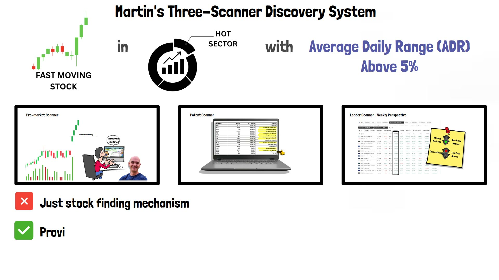

**图解：** 这是E动画中三种扫描器的结构图，帮助分清盘前事件、昨日强度与持续领涨；它没有展示可直接导入软件的完整筛选公式。

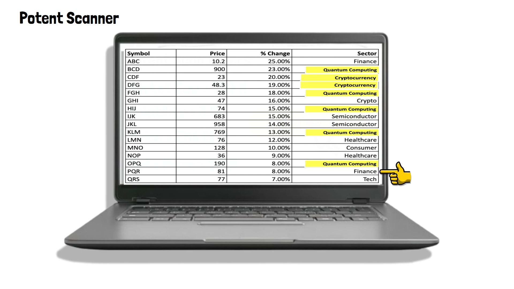

**图解：** 表中ABC等名字是解说示意。学习的是多个同主题名字重复出现时再比较板块，而不是把图上的名字当成真实推荐。E说偏爱热点、快股、ADR通常超过5%；这是偏好描述，不能覆盖第9/10课所有特殊反转工具，也不是ADR越大越好。

### 2.5 名单强弱与订单状态必须分两列

E列出Main、Leading、Mediocre、Lagging、Pillar五组，比本课2.1的教学四组更细；它们解决不同分类问题，可以用两列标签记录，避免反复搬名单造成误解。

| E名单名称 | 用途 | 今天怎样处理 |
|---|---|---|
| Main | 关键股票、眼前想法 | 打开执行卡，写等待位置和触发条件 |
| Leading | 清楚上升趋势；E举EMA9＞21＞50 | 研究回调/整理；已延伸者可以暂不交易 |
| Mediocre | 暂无明确方向 | 等待性格变化，不因无聊而强找入口 |
| Lagging | 下降、弱势股票 | 做多过滤；有权限时另研究第8课空头 |
| Pillar | 影响指数的大型权重股 | 解释指数环境；不等于必须交易这些股 |

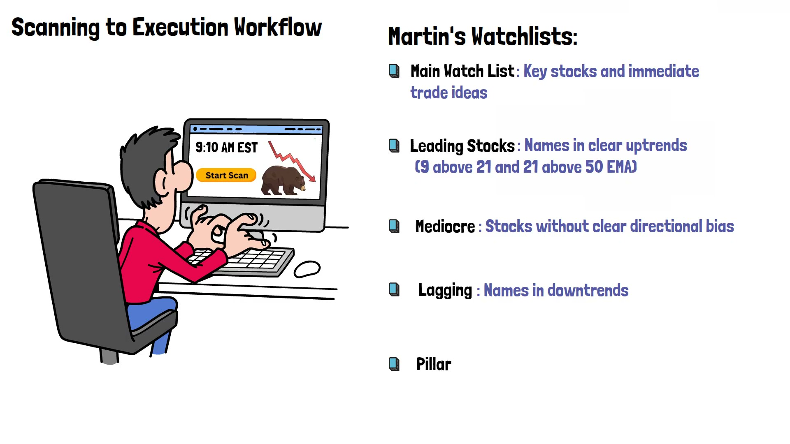

**教学落地：** “强弱角色”填Leading等；另开“执行状态”列，填候选、等位置、等触发、已持仓、已退出。例：一只Leading仍在等回调，另一只Main已经触发但订单取消，不能都算持仓。每天以相同条件保存各组家数与新增/降级名单；Leading减少、Lagging增加提示环境转差，再结合指数与实际新仓反馈调整参与，不设视频未给的自动停手家数。

**盘前完成标准：** 每个Main候选都有代码/场所、板块、日线背景、观察区、所等按钮、失效表现；没有这些字段就仍是研究候选。E说强市准备约30分钟、调整市15～20分钟，A另有45～60分钟经验。时间随任务和机会变化，完成字段比追求固定分钟数更重要。

## 第3课：画出可交易的支撑、阻力和AVWAP

### 3.1 支撑区怎样画

先从日线找一个有实际结构意义的位置，例如刚突破的平台上沿、明显摆动高点被收复后的位置、趋势回调的EMA附近。再看小时图和AVWAP是否在同一带提供参照。

**教学步骤：** 把位置写成区域，同时写出依据和失效表现。例如：“19.80～20.00是观察区，依据是平台上沿与日线EMA21接近。先等下探后的转强；若价格持续落在区域下方、没有收复，就不执行原计划。”这里的数字是教学假设。

区域不是自动买入区。价格进入区域后，仍可能一路下跌；也可能在那里盘整很久。因此“到支撑”只把候选升级为重点观察，不能跳过触发。

### 3.2 AVWAP具体怎样用

AVWAP表示从一个锚点开始累计的成交量加权价格。操作重点是**为何从这一天开始看**，而不是图上多画几条线。

1. 在日线识别已知的关键事件：平台形成时的摆动高点、明显低点或放量跳空日。
2. 用图表软件的锚定VWAP工具，从该K线设置锚点；不同软件的精确操作和数据口径可能不同。
3. 记录锚点日期和理由，切到小时/分钟图观察价格与这条线的反应。
4. 若高点锚定线被有效收复，再研究回测能否成为支撑；若价格仍在其下，反弹时它也可能是阻力。
5. 价格与EMA、前高低接近时，作为共同观察区域，继续等待实际转强/转弱。

视频显示Martin有时会选择相邻、价格更尊重的K线，而非绝对最高/最低K。学习时可记录这种裁量；回测时必须先定义允许怎样选，避免用未来走势寻找最漂亮锚点。

### 3.3 上方空间必须在入场前看

**教学假设：** 买入20.00，止损19.50，每股初始风险0.50。若上方最近明显阻力是20.40，抵达阻力只有0.8R；若下一重要阻力在21.50，距离为3R。两笔即使都叫“突破前K高”，空间不同。

这不是统一最低R门槛，视频没有给出适用于每笔的最低值。它教你先知道会在哪里遇阻，再判断是否值得尝试，避免买完才发现头顶就是小时下降均线。


### 操作拆解：画线之后还必须判断价格是否已经转强

**视频原意（A AVWAP段）：** 常从平台摆动高点/低点、放量跳空事件锚定；重点是价格是否对该线反应。历史NVDA例子里，先有明显强阳收上EMA50的性格变化，再有回撤、较高低点与短均线关系改善。他明确不随机买所有“碰EMA/AVWAP”的回落。

**搭图步骤（教学整理，软件无关）：**

1. 在日线保留EMA9、21、50，必要时补150；写下当前查看的周期。切换到小时图后，同名EMA的含义已变成小时K的根数。
2. 找一个已发生、可在当时指出的事件：平台左侧摆动高、阶段低或明显放量缺口日。记录日期、锚定理由。软件若要求从高/低/典型价等选择计算口径，应把选项记下来；视频未给出其所有设置。
3. 用AVWAP观察该事件之后价格在均价线上下如何转换。原来从下方反弹被压制，后来收复，再第一次回测，是“突破并回测”的结构；仅线下跌得更深不是多头回调。
4. 标出附近已知平台高低点，检查与AVWAP、EMA是否落在接近区域。共振不是要求三条线数值完全相同，也不是允许任意扩大区域直到“总能碰到”。
5. 切小时图观察从日线观察区到上方阻力的路径。最后才用分钟图定触发；分钟图短暂转强不能替代日线恢复的判断。

**原图读法：NVDA性格变化。** 左侧到中部原本是下跌与反复失败；画面中部出现较强绿色K，随后回落没有简单延续旧的单边下跌，短均线关系逐渐改变。读图时先指出这个变化，再看回测均线/AVWAP的机会。后面的整段上涨是事后可见，不能倒推每一次触线都“必然成功”。图为历史复盘示例，不是完整订单记录。

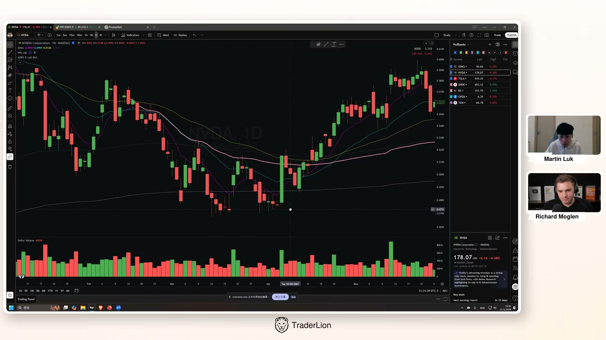

**另一张图说明空头参照。** 下图是IONQ小时图，主结构向下、反弹多次不过下降均线区域。它用于理解同一工具也能观察反弹阻力；不要因为与日线IONQ例子同名，就把它当作日线多头案例的下一分钟。白线的设置必须结合原讲解，不能单靠线条颜色认指标。

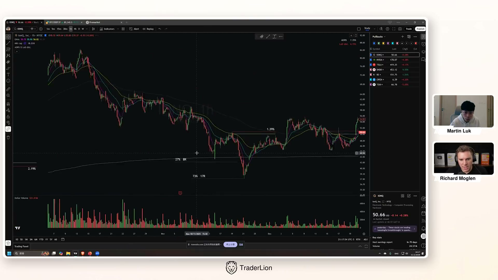

**怎样处理锚点微调：** 他会依据历史反应调整到相邻K线，未坚持绝对最高/最低一根。教学回放要在交易前保存锚点；若调整，只能利用当时已出现的价格，另存版本与理由。没有未来数据的试错和看完涨幅再找最漂亮锚点，是两件事。

**你现在应能写出：** “原阻力是否已收复；回测是第几次；是否有较高低点；均线是转上、走平还是仍向下；哪里失败会使这个转强判断失效。”如果答案只是“价格碰到一条线”，仍未达到进入第4课的条件。

## 第4课：主教程——支撑反转后的回调买入

### 4.1 先判断是不是你要做的回调

优先研究两类背景：已经有相对强势、回到上升支撑的股票；或者平台右侧刚出现转强、收复重要位置、准备首次回测的股票。Martin偏好较早、接近结构支撑的机会，对已经上涨多周、远离理想位置的普通回落更谨慎。

**以下情况先放弃这个模板：** 没有强势或转强依据，只是价格比昨天低；大周期仍明显下降且价格未出现性格变化；上方马上就是密集阻力；原观察区被持续击穿且没有恢复。极端超跌反弹另有模板，见第9课。

低点抬高和波动收窄可以增加结构清晰度，但视频也有快速下探后的V形反转，不要求所有回调先形成同一种紧平台。

### 4.2 盘前先写好计划，不在跳动价格中临时编故事

| 必填项目 | 写法示例：均为教学假设 |
|---|---|
| 候选理由 | 同板块领先，刚突破平台后首次回测 |
| 观察区 | 19.80～20.00，接近平台上沿与上升EMA21 |
| 大周期风险 | 上方21.50有前高，若持续失守19.80则原计划暂停 |
| 执行周期 | 本次用5分钟，不因紧张临时换1分钟 |
| 触发 | 到观察区后出现受阻反转，再突破指定已完成5分钟K高 |
| 初始止损候选 | 实际反转结构低点或所选K低点，待形成后确认 |
| 风险预算 | 账户权益×本笔预算；必须先有股数再下单 |
| 退出方式 | 结构兑现、分批或趋势跟踪，明确观察周期 |

本表是教学整理。视频没有给出每只股票必须填同一表格的制度，但这些问题来自他的实际决策内容。

### 4.3 到观察区以后，逐根做什么

**第一步：等待进入区域。** 未到区域而直线上涨，记为没有提供原计划入口。不要为了“今天必须买到”追过去。若跳空直接落在观察区下方，重新看大周期，而不是默认便宜更多。

**第二步：观察下探是否受阻。** 看价格是否还能轻易创新低，是否收回观察区，是否开始向上推动。一个下影本身不足以保证反转，只是需要继续观察的价格信息。

**第三步：指定触发K。** 在事先选定周期中，找到计划使用的已完成K线，记下其高点；继续观察后续价格向上突破该高点。前K高触发是动态工具，必须在日志里写哪根K，不能盘后任意改选。

**第四步：同时确定止损。** 视频中用过当日低点、相关K低点、前K低点。它们提供不同空间：当日低点通常更宽；小K低点更紧，但更可能被噪声扫出。选择有结构含义且能承受的位置，再按距离算股数。

**第五步：核对可成交价格。** 若突破太快，实际入场已明显偏离计划，重新计算。不能仍按旧触发价算风险，却在更高处成交。视频提过对离低点/理想入口约超过3%的追价谨慎，这是一种当时经验，不是所有工具通用阈值。

**第六步：执行并保留原始计划。** 记录实际入场、初始止损、股数。以后调整止损，也保留初始风险金额，用来算最终实际R。

### 4.4 一笔完整的算例

**教学假设，非视频订单。** 账户10,000美元，本次预算0.5%=50美元。股价进入19.80～20.00观察区，在19.80出现低点；一根已完成5分钟K高为20.10，随后计划在20.12成交，初始止损19.80。

| 项目 | 计算 | 结果 |
|---|---|---:|
| 每股风险 | 20.12−19.80 | 0.32美元 |
| 理论数量 | 50÷0.32 | 156.25股 |
| 不超过预算的整股数量 | 向下取整 | 156股 |
| 计划价格损失 | 156×0.32 | 49.92美元 |
| 仓位金额 | 156×20.12 | 3138.72美元 |
| 仓位占权益 | 3138.72÷10000 | 31.39% |
| 止损距离 | 0.32÷20.12 | 约1.59% |
| 3R价格参照 | 20.12+3×0.32 | 21.08美元 |
| 5R价格参照 | 20.12+5×0.32 | 21.72美元 |

如果平台、流动性或个人组合约束只允许更小仓位，就减少数量；不能因公式得出156股就认为必须买足。示例未计手续费、滑点，止损跳空时实际亏损可能更大。

若实际只能买在20.30，仍止损19.80，每股风险变为0.50，预算50美元只对应100股。继续买156股就变成78美元计划风险，已经不是原来的0.5%。

### 4.5 入场后四种结果

| 价格发展 | 怎样理解 | 处理方向 |
|---|---|---|
| 很快离开支撑并延续 | 与预期反应一致 | 按既定兑现或跟踪方式管理，不因一根小回落随意全卖 |
| 停留支撑附近反复磨 | 预期的快速反应没有出现 | 观察结构是否失效；若反复出现于多个新仓，减少同类交易 |
| 触达初始止损 | 本次尝试失效 | 执行止损，记录损失；是否重入另等新信号 |
| 止损后又上涨 | 时点或止损选择失败，不一定是方向判断错误 | 不把事后上涨补算成自己利润，不直接扩大仓位追回 |

视频没有统一的“入场后几分钟不涨就卖”。若要加入时间止损，应标成独立研究条件，而非替Martin补规则。

### 4.6 AMPX实例：把视频的逻辑完整展开

访谈中，他盘前把约7.45～7.50美元列为值得观察的支撑带，结合日线EMA9/21与AVWAP。开盘上冲后回落，随后用1分钟转强/突破触发尝试。这笔案例的重要内容是：**先有支撑预案，后有回落，最后才有小周期按钮。**

学习时按同样顺序复述：为什么选这只股；为何该价带值得等；价格是否真的进入；哪根小周期K线构成触发；止损依据是什么；头顶是否有阻力。若只能指出盘后日线上的一根上涨K，而不能重建触发时可知的信息，就还没有复现入口。

视频当时的完整历史分钟图和订单数据并非处处可见，教程不伪造具体成交价、数量或收益。它提供的是可复制的分析顺序。

**图解：AMPX日线回调案例。** 这张图从左到右展示上涨、较长整理、再走强。中部价格围绕均线整理，右侧再次向上；水平线和AVWAP帮助讨论平台及回测区域。它展示日线背景，不提供1分钟真实成交；图上收益标注也不能替代独立订单核验。


### 4.7 把“先位置、后触发”落实到每一次看盘

**视频原意：** QS多头讲解中，他找快速下探到小时EMA9/21附近的反转，再观察1、5或15分钟前K高突破；但UPST失败复盘又批评只靠小时线入口、日线已经延伸、平台右侧不够充分的尝试。**这两段要合起来学：小时支撑负责细化位置，不能替日线背景免检。**

先在日线回答“这是平台内/刚转强后较早回测，还是已经上行多周的后段回落”，再到小时图定位，最后才切分钟。普通回调模板里，他至少希望离日线支撑不要太远；“所有股票碰小时EMA21就买”不是其完整做法。极端超跌反转另见第9课，不能拿其低位反弹给普通弱股抄底背书。

**三种到位方式及应有动作（教学解释）：**

| 眼前发生什么 | 你应观察什么 | 不能跳过的判断 |
|---|---|---|
| 急跌到事先支撑，随后快速收回 | 哪一根已完成分钟K提供向上触发参照；最近下探低点在哪里 | 大周期位置是否仍成立，而非跌得快就反转 |
| 缓慢磨到支撑，反复突破又退回 | 是否一直缺少推进，是否应降低回调频率或等新整理 | 不在相同噪声中无限次试同一个入口 |
| 先上冲，之后才回落到支撑 | 是否真正进入盘前观察区，转强能否在附近完成 | 不因为开盘涨过，就把后面任何小反弹都叫强势 |

这里“快”“慢”是价格行为描述，四视频没有给秒数或ATR阈值。回放中要写具体K线变化，不能只写“感觉强”。

### 4.8 前K高到底怎样用：参考K完成，触发K可以尚未收盘

**先分清两根K：** 参考K是提供高点的已完成K；触发K是后面价格突破它高点的那根。视频使用的是前K高被突破的盘中触发，不等于统一要求触发K也收完才买。等待强收盘后回踩属于第5课的另一种入口。

**可直接练习的识别步骤（教学整理）：**

1. 回放停在支撑附近，选定执行周期，例如1分钟。确认支撑观察成立后，记录最近已完成K的结束时间与高低点。
2. 下一根运行中，若向上穿过参考高点，记“触发出现”。若仍继续向下，不提前记成交。
3. 下一根结束仍未触发时，可以按“前一根”逻辑更新参照，但要先写更新规则并保留原记录。不是盘后随意选择一根最有利的K高。
4. 触发出现时同时检查实际可成交价、止损距离和数量；可见突破不等于一定按高点成交。他在QS讲解中承认可能有滑点或进晚。
5. 若只掌握一根K的OHLC，且同根同时越过触发价与止损价，先标记“路径不明”。需要更细时间数据才能知道先后，不自动把最低价当作先发生。

**未披露的部分：** 是否每次严格用紧邻前K、遇内包链如何选母K、触发加多少跳、采用哪种买入订单、未成交多久撤单，没有完整统一规定。本教程的演练会固定一种可复核选择，但不称它为Martin唯一规则。

### 4.9 1分钟还是5分钟：保留时段经验，也保留不确定性

A讲解把开盘早段的反转与1分钟联系，随后转用5分钟；现有Whisper及FunASR两份转写对“开盘前/后15分钟”和后一个边界数值仍存在含混。**能确认的是他会按时段切换执行周期，不能可靠锁定一张分钟分界表。** 本次不把疑问删掉，也不把猜测写成确定规则。

C首播又说，在当时震荡环境倾向回避最初15分钟，除非机会很好或开盘区间突破有效；D空头更新不喜欢最初15～30分钟追跌。因此先决定今天是否适合早段参与，再决定用哪个周期。不能从A推导“开盘一定用1分钟买”，也不能从C推导“全年前15分钟禁止买”。

**练习时的处理（教学方案）：** 每次只选一套明确周期及时段，分别做样本。1分钟入口失败后切5分钟、再失败切15分钟，应登记为新的尝试与新增损失，不能说是“同一笔还没错”。这个固定记录办法用于训练，不是他披露的强制制度。

### 4.10 止损比较：宽结构止损与紧K线止损不是优劣排序

**视频原意：** 他自述约60%～70%情形参考当日低点，也会参考突破K低或前K低。若下探K有很长下影，从预期入场到当日低点太宽，他会考虑较近K低。本人明确没有每笔统一的硬选择，且认为当日低点方案可能更不容易被扫出；这属于其经验，不是经本教程统计的结论。

**下单前先列两列，不能先定大仓位再倒找小止损：**

| 比较项目 | 当日低点方案 | 相关分钟K低点方案 |
|---|---|---|
| 哪个结构失败时认错 | 此次日内下探形成的低点被破坏 | 较局部的反转/触发结构被破坏 |
| 距离通常怎样 | 可能较宽，长下影时尤其明显 | 可能较紧，对局部噪声更敏感 |
| 相同账户预算怎样配数量 | 股数较少 | 股数较多 |
| 代价怎样记录 | 成交后更大价格回撤才退出 | 可能先止损，价格再朝原方向走 |

**教学假设：** 预计买入20.12，当日低点19.50，参考K低19.90，预算50美元。宽方案每股风险0.62，最多80股，计划损失49.60；紧方案每股0.22，最多227股，计划损失49.94。后者并没有把账户风险降到前者的三分之一，只是换成更大的数量。若实际买到20.25，两方案都要重新计算，不能还用旧数量。

**突破K还没结束时怎样处理？** 它的最终最低点尚未知，不能用盘后最终K低来假设当时已经下好止损。练习可选“上一根已完成K低”或“当时已形成的低点”，记录选择时间；若后来调整，也留下调整记录。这是消除前视偏差的教学办法，视频未披露统一的盘中更新算法。

**三种取消：** 只有把止损硬挤进无意义噪声里才能达到想要数量；实际成交离支撑太远，头顶空间被压缩；或者支撑背景已经破坏。取消不等于判断后面必跌，只是没有满足自己这笔尝试的条件。

### 4.11 QS多头原图拆解：不要把反转后的上涨当作入场前的保证

下面是A访谈中的**QS多头失败例**，与第8课C直播里的QS空单不同，价格区间与日期也不同。

**图一：先辨认急跌与下探末端。** 左侧开盘急拉后快速下杀，中部低位几根K发生反转，随后右侧有一段反弹。口述将这一入口联系到小时EMA9/21支撑；本图显示1分钟，不能把图内所有均线当作小时均线。你要在回放时遮住反转之后的走势，先判断急跌到哪里、哪根参考K已经完成。

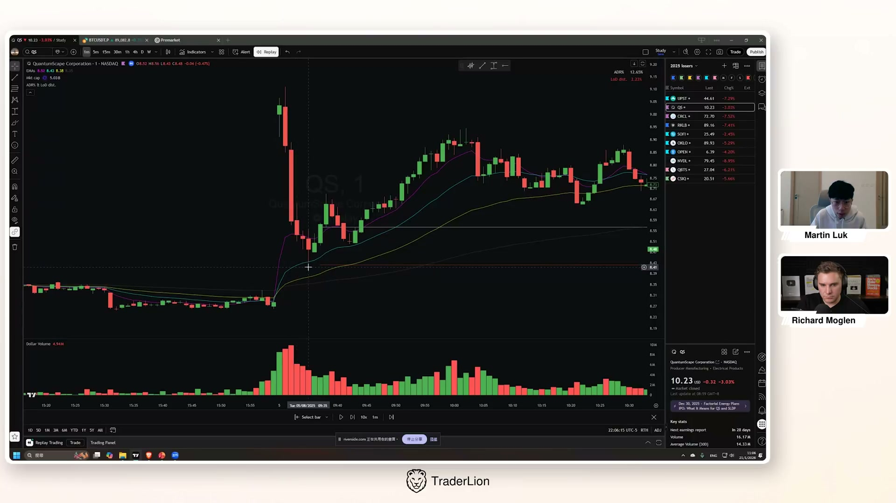

**图二：向上突破参考高点是触发，成交可能更晚。** 鼠标在中部低点右侧第一段反弹K附近，他讲的是前K高突破。图中可见短暂上行后又回撤，再上行；不能把最早低点价格当成自己的成交价，也不能因为后面反弹而抹去紧止损可能提前出局的路径。

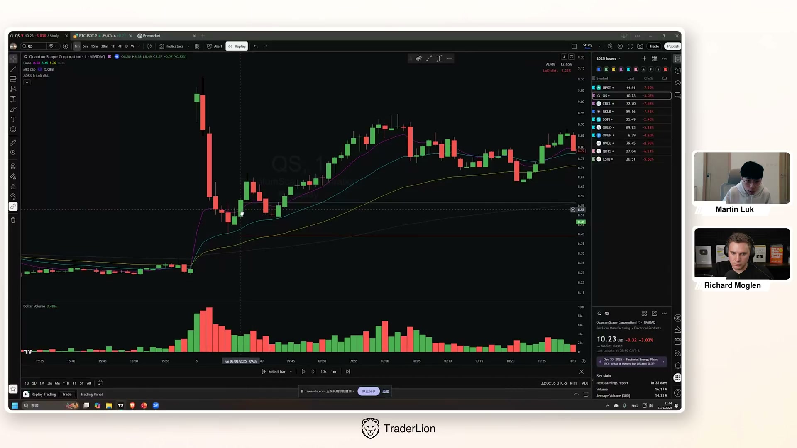

**图三：长下影使当日低点止损更远。** 他解释若长下影拉大了到日低的距离，就可能用较近K低替代。图内底部针脚、反弹K低与之后更高的局部低点，是不同候选。图只支持比较这些结构，不能从鼠标或十字线反推精确券商止损指令。

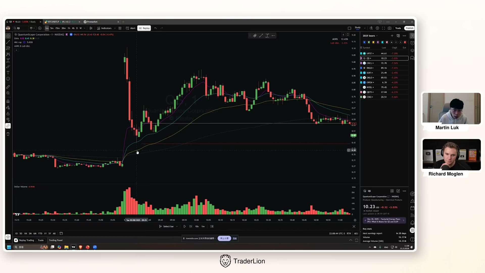

**图四：切到5分钟是另一日期示范。** 屏幕显示2025年7月30日，前面的1分钟图显示8月5日。这里解释同一种前K高工具在5分钟图如何看，不能拼成“1分钟失败后同一笔切5分钟补仓”的真实流水。

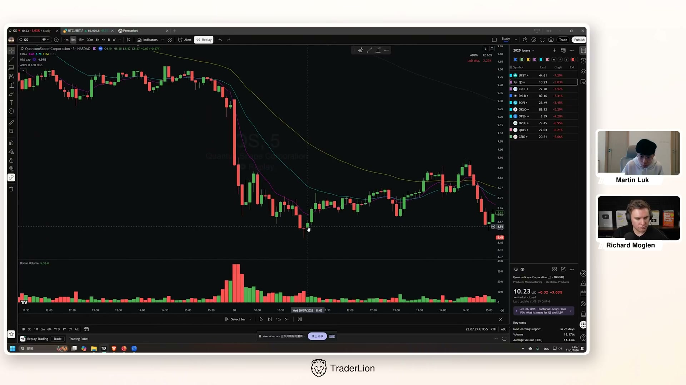

**本例能还原什么：** 快速下探、用小时支撑定位、分钟前K高触发、滑点/进晚可能、多个止损候选及最终失败。**不能还原什么：** 唯一精确成交时刻、完整仓位、各次调整的券商指令、每次重入流水。不要用图中大致价位补造成交记录。

### 4.12 AMPX：把盘前预案与盘中执行分开记录

**盘前能知道的：** EMA9/21、AVWAP附近大致在7.45～7.50美元。它们给出待观察区域，不会提前告诉你最低点、触发K或当天涨幅。

**盘中他说做了什么：** 开盘上冲后回落至该区域附近，再买1分钟前K高突破。口述先提5分钟后改为1分钟，教材保留其修正，不写两种都实际成交。

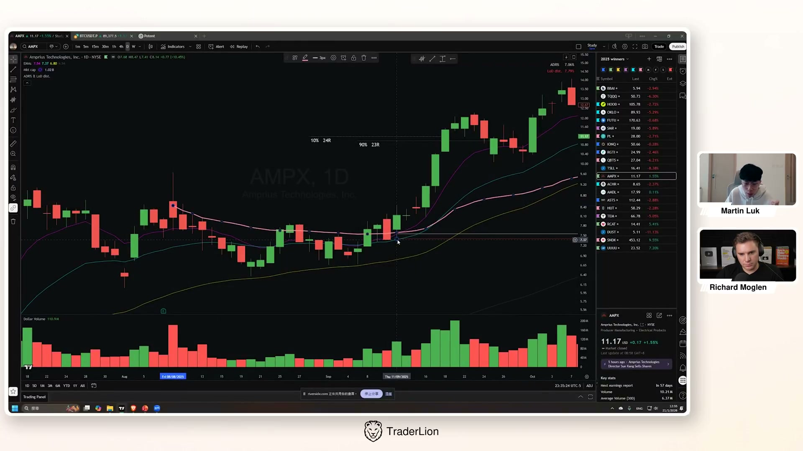

**图上可见：** 日线平台右侧开始转强，短均线及较粗的锚定线靠近7.5一带，后面才出现显著上涨。**这段录屏没有给出可用于逐根重建的完整1分钟订单图。** 因而真实入口逻辑可以写清，不能凭这张日线画一根假的分钟买入箭头。

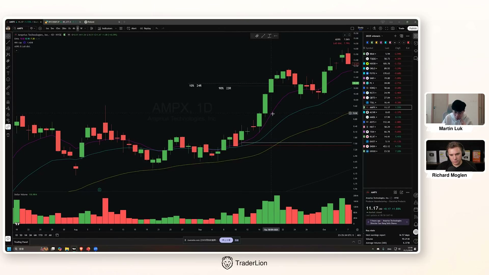

他也谈到卖早、市场延伸时过于谨慎，以及若用EMA9跟踪，希望给下探留空间。因此本例不是“回调进场后固定赚多少”的例证，而是入口有效与退出仍可改进并存。

**可以照着做的回放卡：** 截止盘前先画区域；到位前只观察；到位后切事先确定的分钟周期；触发前记录参考K高与候选止损；成交后保存实际价格/股数；没有到位或没有触发则记录未成交。AMPX真实订单缺失的细节，用下一课后面的虚构数据练习补操作能力，不补进他的真实案例。

## 第5课：确认后回踩——错过第一次突破以后怎样处理

### 5.1 这种入口解决什么问题

有时价格从支撑直接推起，你没有赶上前K高突破。另一种选择是先让所看周期的一根K线完成，确认收得较强、回到均线上方，再等回踩。与第4课相比，它接受确认更充分、价格未必最早的代价，换取新的观察依据。

### 5.2 操作顺序

1. 先保留原来的大周期背景，不因错过而降低选股要求。
2. 指定确认周期。USO讲解先展示小时图、随后切15分钟；可确认回踩参照为15分钟EMA9，不能仅凭这一点断定前面等待收盘的也是15分钟。教学演练可以自定15分钟确认，但必须标为演练选择。
3. 观察这根K是否收强、收复相关均线或关键位。不是所有绿色K线都叫确认。
4. 等价格向对应支撑回踩；USO案例提到15分钟EMA9。
5. 回踩中重新检查结构和风险。正文不将“碰到EMA9”编成机械买入指令，也不补造该案例未披露的精确止损。
6. 若不回踩，记为未成交；若回踩持续破坏刚建立的强势，取消原入口。是否改用第4课小周期确认，应在模拟计划中事先说明。

### 5.3 USO实例的前因后果

10月12日直播中，他喜欢原油的日线U&R及周线支撑结构，表示等回调。次日直播里，他讲此前一笔USO止损，后来错过上涨突破，于是等K线收强，再买向15分钟EMA9的回踩，并提到均线交叉。

这说明**第一次失败和错过突破后，都可以重新等待新的可执行结构**。它没有证明任何止损都该重入，也没有证明每笔必须金叉。

特别注意：口述交易标的是USO，但分析画面是USOIL/WTI。你可以用相关图辅助方向判断，却必须在实际下单标的上重新算入场、止损和股数。不能把原油的美元报价当作USO股价。

**图解：USOIL 15分钟确认回踩分析图。** 左侧是下行，右侧先下探再快速收复，价格重新推回多条均线上方。阅读时关注收复和随后回踩的先后顺序。画面代码是USOIL、周期15分钟，口述订单是USO，因此图中价格不能直接用于USO股数计算。


### 5.4 两种回调入口怎样选

| 问题 | 支撑反转后突破前K高 | 确认后等回踩 |
|---|---|---|
| 等待什么 | 支撑反应与小周期向上触发 | 指定周期先收强，再给回踩 |
| 主要代价 | 较早，可能被短线噪声扫出 | 可能不回踩，从而错过 |
| 最容易犯的错 | 任何小K突破都买 | 把任何回落碰均线都叫回踩确认 |
| 共同要求 | 大周期位置、明确止损、按实际成交算风险 | 同左 |

不要在同一笔失败后，把自己没遵守的入口换成另一套说辞。回放练习时给每笔只选一种主要入口，才能比较结果。


### 5.5 USO过程复原：止损、错过、确认、回踩是四个步骤

**视频原意（B USO两个片段，D前日观察）：** 前日已有日线U&R与周线支撑的观察；B里他说先前尝试将止损放绿色K低，被扫出。后面新的向上突破又错过，于是等K线收盘；收得较强、回到EMA上方后，改买向15分钟EMA9的回踩，并提到均线交叉。这不是止损后立即原价买回。

| 阶段 | 当时新增的信息 | 对应动作 | 这时还不知道什么 |
|---|---|---|---|
| 初次尝试失败 | 原计划止损被触达 | 结束原尝试并记录亏损 | 后面会不会再涨 |
| 再次上推但错过 | 看见向上突破，没有及时成交 | 不追溯补一笔“本来买到” | 这根K最后是否收强 |
| 等收盘确认 | 该根完成且收复均线区域 | 建立新的回踩观察方案 | 是否会给回踩、回踩会否失败 |
| 回踩到15分钟EMA9附近 | 出现他愿意交易的回落入口 | 按实际下单工具重新算风险 | 最终收益及是否还能继续上涨 |

**图一为小时图。** 右侧低点之后强绿K收回短均线区域，再有后续抬升。结合讲解理解“先确认反弹强度”；不能把这张小时图里的EMA9叫作15分钟EMA9。

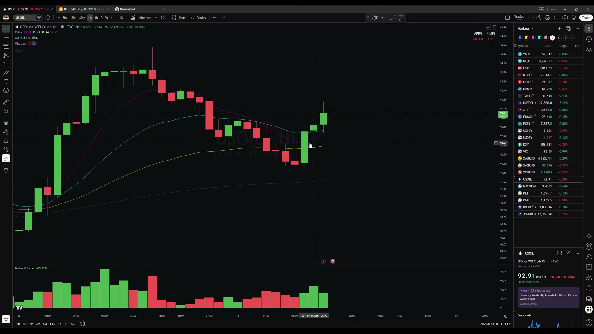

**图二为15分钟图。** 右侧从低位向上恢复，在强推过程中仍有回落与针脚；他把入场联系到该周期EMA9回踩。鼠标附近的历史K帮助指示回踩位置，但没有券商成交标记，不能认定鼠标价就是精确入场价。

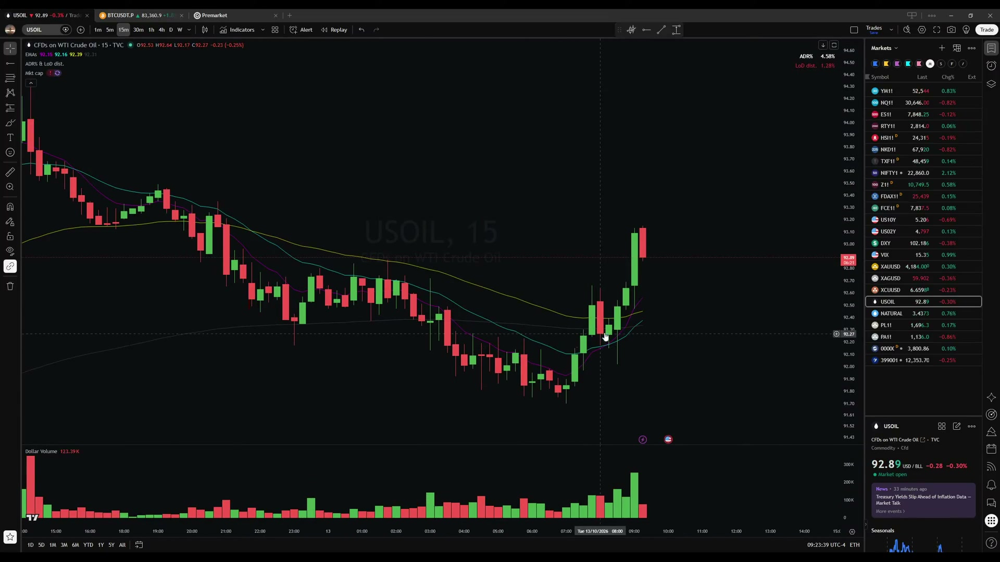

两图都是USOIL分析图，口述订单为USO。等待确认K的确切周期不能只根据15分钟回踩参照推断；原讲解与画面切换不足以将其固定为通用规定。需要在USO自己的报价上求每股风险，不能把原油点数直接当ETF美元价格。原素材没有完整披露这次重入的止损，正文不会补成“必定放15分钟前K低”。

### 5.6 不追突破以后怎样等待：完整教学演练

**以下是虚构同一股票的数据，不是USO成交。** 大周期支撑19.80～20.00；15分钟确认K收在20.40、回到所看均线区域上方；首次突破未成交。现设教学回踩区20.15～20.25，并事先选择“回踩后再用1分钟前K高触发”作为练习版本；这一步是额外训练选择，不声称USO原单也这样做。

- 价格直接从20.40去20.80：回踩订单未发生，记录错过，不把20.20当作成交。
- 回到20.22，但仍持续向下：只有到位，没有转强触发，继续等待或取消。
- 回到20.18，形成参考K高20.24、低20.16；下一根向上越过20.24：记录触发。假设实际20.25买入，按事先选定的19.98结构止损，50美元预算最多185股，价格风险49.95美元。
- 如果到触发时支撑已破坏，或实际只能20.50成交，原方案不能原封不动执行。用20.50与19.98计算，最多96股；也可以取消并记下原因。

确认K是15分钟，额外触发K是1分钟，止损又可来自更大结构：三个角色不同。不要把“切周期”理解成谁给自己想要的答案就用谁。

**本课检查问题：** 你等的是第一下向上突破，还是确认之后的第二次回落？确认是哪根已经结束的K？回踩区是哪张图上的线？实际下单工具是哪一个？止损的依据是否事先存在？不能回答这些，就暂时不在日志中写“按USO模式交易”。

## 第6课：平台、内包线与延续突破

### 6.1 先认识结构

平台是价格在一定区域反复整理；内包线是本根K的高低范围包含在上一根范围内。日线内包称内包日，周线内包称内包周。内包只说明范围收窄，不能单独证明下一步向上。

视频展示FUTU内包日、HOOD小平台、RGTI旗形/内包周、AMD整理、ASTS较长底部突破。共同重点是股票已有值得关注的强势或转强背景，整理以后向上推进。Martin偏好较长底部后的首次突破，可能对应新趋势开始的位置。

### 6.2 下单前把范围定义清楚

1. 在日线/周线标出整理范围和上沿，注明它在趋势早期还是后段。
2. 看平台上方是否紧接历史供应区；不能因为突破“最近小平台”就忽略更大前高。
3. 选执行方式：直接交易结构突破，或等开盘区间/前K高触发。视频有多种实例，没有统一开盘区间长度。
4. 指定止损参照，例如相关K低点、当日低点或平台失效位，并算风险。
5. 若跳空开在上沿很远处，重新判断距离和风险；不是看到突破就无条件追。

### 6.3 开盘区间怎么使用

**教学假设：** 你事先选择开盘后的最初5分钟作为区间，区间高为30.20、低为29.80。5分钟结束后，向上突破30.20是这个区间的突破；但11点时随便一根5分钟K高，不是同一个开盘区间高。

如果假设成交30.22、止损29.80，每股风险0.42；账户预算50美元，整股数量不超过119股，计划损失49.98美元。这个区间长度和数字仅用于演练，不能称为Martin规定。

若第一次突破后迅速回到区间中，是否退出取决于已选结构/止损，而非看见红K就临时发明规则。后面重新收紧、再突破，可以作为新的尝试研究，但需要重新确认并累计前次损失。

### 6.4 常见错误与出场

最常见错误是把盘后看见的“漂亮平台”当成盘中必定能识别的形态，或用仍未完成的内包K线制定已确认范围。回放时停在触发前，先写界线，再放下一根。

出场沿第12课的分批、延伸或趋势跟踪处理。视频个别订单止损接近开盘价，但本人承认可能激进，教程不将开盘价列为默认止损。平台突破也不意味着可以容忍一切回落，只要“长期看好”就不卖。


### 6.5 三种突破实例：形态背景不同，触发工具可以相同

**HOOD：强股不一定回到最深的支撑。** 他关注两天回落到EMA21后收在EMA9上方的较强表现，再买小平台突破。AVWAP在更下方，可以用于另一个回调预案，但这次价格没有回去，因此实际做了突破。教学重点是同时预先准备合理入口，而不是为了等一条线强迫价格满足想象。

**FUTU：内包日只是范围，不是方向保证。** 他描述多次回落后范围收紧、沿EMA9运行，再交易内包日突破。实际准备时先记录母K与内包K高低点；到底突破内包高还是母K高，要写清楚。本片没有给出适用于所有内包链的唯一选K制度，不能只写“内包日突破”就假装订单价已经确定。

**RGTI：日线小旗形与周线配合。** 他观察到EMA9上方的短整理、数次回测后跳空，再用开盘区间高突破较早入场；自己称较激进，如果不成功，可能等另一日整理。他没有给统一开盘区间分钟数，也没有把不成功自动解释为当天马上补仓。

### 6.6 从画平台到提交模拟订单的操作顺序

1. 在突破之前截图，记录上沿由哪些既有高点构成、下沿由哪些低点构成，说明选的是日线平台、内包范围还是开盘区间。不同结构的界线不要混用。
2. 查周线位置。ASTS例子强调长平台之后第一次向上展开；较短中继平台与长期底部第一次突破，潜在持仓背景不同。
3. 查看突破上沿到更大前高、下降EMA或AVWAP的距离。OKLO复盘中，他承认在EMA50下方直接买突破，可能很快顶到EMA50；后来转强回踩的位置在他看来更好。盈利不能替原入口免除这项检查。
4. 选择一个触发：平台上沿突破、指定前日高、或事先定义开盘区间高。不要同时保留多个价位，盘后只挑成交效果最好的那个。
5. 对应一个失效结构并计算数量。止损设在相关K低、日低或平台失效处，都必须写明；视频没有证明“平台突破默认止损开盘价”。
6. 未触发则不成交；跳空越过原入场区域，则按真实价格重新量风险与空间。把这种情况记为“跳过计划价”，与正常触发分开统计。

**教学假设：** 内包K高30.20、低29.80，母K高30.50、低29.50。若计划交易内包高突破，预计30.22买、29.80止损，50美元预算最多119股；若实际计划交易母K高，预计30.52买、29.80止损，最多69股。两笔的触发、等待时间与数量都不同，不能只写相同的“内包突破”。

**失败怎样记：** 突破后触及原止损，按计划计入失败；如果稍后重新收紧再突破，是新样本。若只是原区间内来回穿越，就没有新的大周期理由，不能靠连续换1/5/15分钟掩饰重复尝试。视频提到这种行为可累计多次小损失。

**退出怎样选：** HOOD、AMD等他曾在强势或盘中反转时较早兑现，事后也承认可能少赚；OKLO有首次收盘低于EMA9结束的例子。它们说明退出存在不同选择，不说明可以事后任意用最大涨幅作自己的收益。

### 6.7 昨日高点、开盘区间、盘中小平台：同叫突破也不能混用

**E博主归纳：** 它重点讲昨日高突破、1/5分钟开盘区间突破，以及初次失败后在EMA9上方盘整再突破。这能补充本课按钮比较，却不能把A～D的支撑回调和收盘确认回踩都改成“只买昨日高”。

| 按钮 | 事先锁定的边界 | 允许触发前必须已有的信息 | 失败后如何重新判断 |
|---|---|---|---|
| 昨日高突破 | 前一完整交易日高点 | 昨日交易时段定义、今日背景和止损 | 回到昨日范围内先记录原尝试结果，再等新结构 |
| 开盘区间突破ORB | 已完成的开盘1分钟或5分钟范围 | 区间形成完毕；是否含盘前另注明 | 原区间破坏后，不继续叫同一笔有效突破 |
| 盘中整理再突破 | 当时已经形成的小平台高点 | 平台所在周期、上下沿及均线关系 | 等新平台/参考K；新单重新计风险 |
| 回调前K高 | 选定周期已完成参考K的高点 | 先有支撑到位/转强理由 | 回到第4课失效与重入流程 |

**教学练法：** 开盘前在日志注明今天只练哪一按钮。若用5分钟开盘区间，就等该区间完成，不能在第2分钟用未来5分钟最终高低计算成交和止损。若昨日高恰好等于小时高，日志仍分别写两个出处；价格巧合不能代替边界定义。突破K尚未收盘可以发生触发，但用于界定区间的参考K必须已完成。E未提供足以消除A时段措辞疑点的新一手证据，4.9的不确定性继续保留。

## 第7课：跌破后收复（U&R）

### 7.1 与普通回调的区别

普通健康整理可能一直低点抬高；U&R则先跌破一个已经存在的低点或关键位，再重新收复。先跌破并不自动成为买点，**收复才提供新的信息**。视频还讨论均线下探后收复，记录时区分水平低点和均线。

### 7.2 可以逐根演练的顺序

1. 在下穿之前标出已有参考低点，例如日线某摆动低点。
2. 价格跌破它时，先标为“下穿”，不预先宣称必然反转。
3. 若价格回到该位上方，观察是在盘中短暂收复，还是所选周期已经收复完成。
4. 结合周/日线趋势、EMA和上方空间判断是否值得研究多头。
5. 选定执行触发与失效点，再按订单标的计算风险。

第5步中的具体止损算法，四视频没有给出统一版本。练习时可将“新形成的下探低点”列为待检验的结构候选，但要标明是教学方案，不能说Martin所有U&R都这样设。

### 7.3 三种走势不要混淆

| 走势 | 能否称为已出现U&R | 学习时怎样处理 |
|---|---|---|
| 跌破后一直走低 | 不能 | 原多头条件未出现，继续等待或放弃 |
| 收复后马上重新失守 | 有过收复，但随后失败 | 按计划认定失效，不用“洗盘”解释所有下跌 |
| 收复后在上方稳定并转强 | 可研究完成后的入口 | 仍检查阻力、止损和可成交位置 |

原油案例把日线U&R、周线EMA9/21支撑和突破前周K高结合起来观察。它不是仅凭一次分钟假跌破就认定周线趋势反转。没有统一跌破百分比、收复时间上限或强制收盘条件，量化时需另行定义。


### 操作拆解：先明确“下穿了谁”，再谈收复

U&R中的U不是泛指跌，R也不是泛指一根绿K。**教学定义：** 先有可在当时识别的旧低点或支撑参照，价格穿到其下，随后回到其上。若参照是EMA，应明确写“下探均线后收复”；若参照是水平低点，写该低点的日期与价格，二者分开记录。

**逐根记录模板：**

| 记录时刻 | 当时能写出的事实 | 对应观察 |
|---|---|---|
| 下穿前 | 旧低点L已存在，不根据后面走势更换 | 准备观察，不提前买入 |
| 下穿时 | 现价低于L，新低仍可能继续出现 | 不把“跌破”自动解释成洗盘 |
| 首次回到L上方 | 发生收复，但这根K可能还未完成 | 注明是盘中收复还是收盘确认 |
| 收复后的回测/整理 | 查看是否在L附近获得支持，以及上方阻力 | 准备自己的执行与止损方案 |
| 再失守所选失效结构 | 原尝试失败 | 按预案退出或取消，不无限放宽定义 |

**视频原意：** 原油讨论把日线U&R、周线EMA9/21支撑、前周K高突破联系起来。周线背景是在描述较大结构，不是告诉你可以用一次分钟假跌破就确认长期趋势。

**完整教学例：** 旧低20.00，盘中低到19.80，然后回到20.00上方。只做回放时，可以明确规定“等一根5分钟收回20.00，再用下一根前K高突破进入”，止损候选19.78；这些确认、缓冲和订单安排均为教学假设，不是视频披露的统一U&R参数。假设最终20.12成交，风险每股0.34，50美元预算最多147股。若下一段未触发，则零成交；若又跌破失效点，则失败，不因后面反弹改成盈利样本。

**必须留空的部分：** 容许下穿百分比、收复必须在几根K内、是否每次要等日线收盘、固定止损算法。本例说明怎样把不完整的裁量描述变成可检验训练方案，不意味着视频已经验证了此方案。

## 第8课：反弹遇阻做空，以及急涨后上推失败

### 8.1 第一种背景：破位后的首次反弹

Martin描述的理想图景是：首次失守EMA50等重要位置，随后第一次反抽；EMA9/21已转弱、接近或开始下穿EMA50，可能同时遇到AVWAP；价格最好先向阻力区上冲，再出现转弱。这比已经跌了很多、才在最低附近追空更符合其偏好。

这是一种理想位置，不是每笔必须同时满足的数学清单。更重要的是，相对板块弱势、阻力清楚、下方仍有空间，而不是只看短周期一根红K。

### 8.2 从选股到执行的步骤

1. **找相对弱股：** 板块反弹时它恢复更少、较早见顶、已形成较低高点或破位。
2. **标反弹阻力：** 下降日线EMA9/21/50、前低变阻力、高点AVWAP；再用小时图补充。
3. **标下方支撑：** 日线EMA50、周线EMA9、缺口和旧低点。下方空间太近时，小周期走弱也未必值得做。
4. **等反弹进入区域：** 不因价格已经持续下跌而追着卖空。若一直不反弹，允许没有订单。
5. **等转弱按钮：** 视频有5分钟前K低跌破；明确哪根已完成K的低点，不把刚触及下降均线当作转弱已完成。
6. **定止损与数量：** 止损可参考相关K高或当日高，卖空风险为止损价减入场价。
7. **持仓看下方空间与阶段：** 到支撑、明显延伸时考虑回补；逆指数上升趋势的空头更倾向快速处理。

### 8.3 直接卖空的算例

**教学假设：** 账户10,000美元，预算50美元；反弹受阻后卖空40.00，止损40.60。每股风险0.60，整股数量83股，计划价格损失49.80美元，名义仓位3320美元。

1R向下价格为39.40，3R为38.20，5R为37.00。若最近下方支撑就在39.50，潜在路程只有约0.83R，应重新评估，而不是因为止损紧就认为值得做。视频未规定统一最低R，本例是教你提前衡量空间。

直接卖空需要核对借券、保证金和执行条件；买反向ETF属于另一个订单方向。不能把“看空板块”自动翻译成卖空图上任何代码。

### 8.4 QS失败例：把止损代价看完整

首播里，他明确说刚做空QS，按钮是5分钟前K低跌破；背景包括日线EMA9/21靠拢、摆动高点AVWAP，以及小时均线下降、靠拢。后来这笔止损，价格却继续下行。

复盘时他说明止损在相关5分钟K高附近约15.98美元，某根K高到16.00，两美分将他扫出。他承认这就是紧止损的代价。又比较约1.3%的紧止损与约2.8%的当日高点止损，风险不变时后者对应数量约为前者一半；实际该笔风险低于账户0.5%。

你要学到的不是“下次多留两美分就好”，因为未来不会总只多两美分。应当在入场前比较两套方案：紧止损、小噪声就可能出局；较宽结构止损、股数相应减小。要比较完整样本中的损失和最终收益，不能拿止损后的最低点推算自己本来赚多少R。

**图解：QS空头讨论时的日线。** 日线右侧靠近短均线的整理，供判断大周期位置；右边名单分持仓、想法、多头和空头类别。该图解释为何关注QS，不能单凭日线看到5分钟止损触发，更不能将名单全部当已成交仓位。


### 8.5 SNDK：为什么从多头转为空头

空头更新中，他回顾SNDK此前做多，随后在相关K低/EMA9附近破坏时退出。之后它相对半导体板块及存储股走弱，他从摆动高点锚定AVWAP，持续观察。弱收盘以后，计划等下一交易日反弹；价格向下降日线EMA9反弹，同时小时图也弱，才尝试做空。

这条推理链是：**原多头退出 → 观察相对弱势 → 标新阻力 → 等反弹转弱。** 不是卖掉多头的一刻立即反手。

后来他在另一反弹加仓，并明确称激进、不建议照抄。另一期直播又讲SNDK第一次空头尝试止损后重新观察日线EMA9和盘中弱势，再次入场。它们说明可等待新结构重入，但不能拼成已核实的跨日全部订单流水，也没有提供固定加仓倍数。

### 8.6 第二种背景：急涨、首次破坏、再上推失败

这种空头比“已成下降趋势后反抽”更接近趋势转折。历史CSCO和MSTR讲解中，前面已有显著加速上涨，首次回撤以后，股票还可能再次收紧、看起来像杯柄或VCP，试图恢复上涨。第二次向上推动失败，或形成第一个较低高点、重新破位，才是另一种可研究位置。

**教学观察顺序：**

1. 先确认前面的异常上涨与首次破坏都已发生。
2. 等它尝试恢复，避免仅因“涨太多”便一路提前做空。
3. 看再上推有没有真实突破和跟随；若已经失败，记录失败位置和对应周期。
4. 标出新阻力，再寻找可限定风险的小周期转弱。
5. 若它真正恢复强势并持续突破，承认空头假设未获确认。

Martin指出，某些破坏发生时仍在周线EMA9上方。因此不能要求所有转折都先跌破50，也不能把它与第10课直接抓极端顶部混在一起统计。半导体是他当时的结构类比，不能当作事后必然崩跌的证明。

**图解：CSCO历史周线：再上推与后续破坏。** 图表代码CSCO、周期周线，历史区间跨越1999至2002。上涨顶区之后有多次恢复尝试，随后逐步破坏并进入下行。用它理解先破坏、再上推、再失败的阶段，不把这张事后全图当成当时已知未来。


### 8.7 用反例检查你的空头计划

RDDT曾反弹到下降EMA9/21，却恢复强势、让他两次止损。RKLB复盘中，小周期转弱下方不远仍有日线EMA50/周线EMA9支撑。NVDA过急的空头尝试也被他归为不该做的交易。它们分别提醒：阻力可能失败、空间可能不足、强股的小周期走弱未必是大周期转折。

AAOI讨论则提供正向位置观察：比市场/板块较早见顶，已有较低高点，反弹到小时EMA21/50附近转弱。该段是对入口的评价，教程不把它说成已独立核验的真实订单。


### 操作拆解一：做空先等反弹，不能把跌得多当作入口

**视频原意：** 理想位置是首次失守日线EMA50后的首次反抽，短EMA9/21也转弱并接近EMA50，若同时有AVWAP及反弹过冲更理想。D半导体例子明确表示不喜欢开盘最初15～30分钟追着下跌做空，宁愿等反弹向阻力推，再用5分钟前K低跌破。

**从上到下检查：** 大周期是否已破坏或显出相对弱势 → 反弹要等到哪个阻力区域 → 下方最近支撑在哪里 → 到区域以后哪根已完成5分钟K低作为按钮 → 相关K高或当日高作为哪种止损 → 实际卖空价格与可借券条件。任一步只有“想空”而无事实，就保留候选状态。

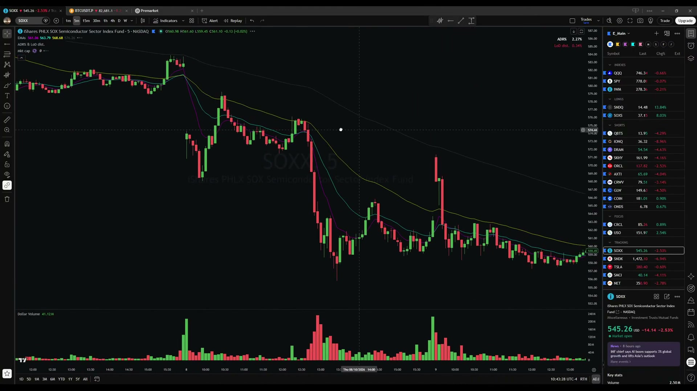

这张图左中部有明显向下破坏，随后多次反弹被压，右侧继续走低。口述讲的是“反弹上推后再跌破”的入口。不要以右侧已知最低点作为卖出价，也不要把分析图SOXX当作已核实的实际下单工具。小时某条均线的周期/编号在转写中有分歧，正文保留“多项阻力靠近”的确定部分，不强写争议编号。

### 操作拆解二：QS空单的三张图，解释为什么方向对仍会亏损

**这是C首播QS空单，不是第4课A访谈QS多头。** 他明确说刚做空，触发为5分钟前K低跌破；日线EMA9/21靠近、高点锚定AVWAP以及小时均线向下，构成背景。

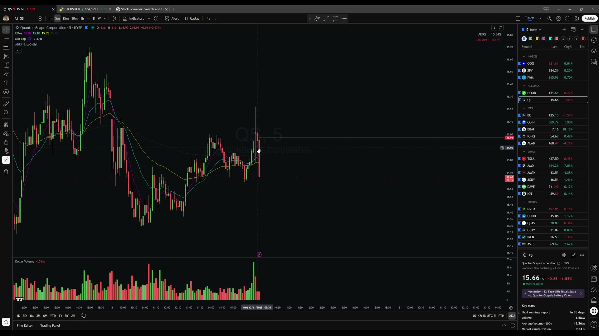

**第一张图（5分钟）：** 中部反弹以后有一段下破，红水平线标15.98。该线结合后来的口述支持其止损位置，但画面不是券商成交单，不能从十字线反推唯一卖空成交价。后面仍可能先反弹。

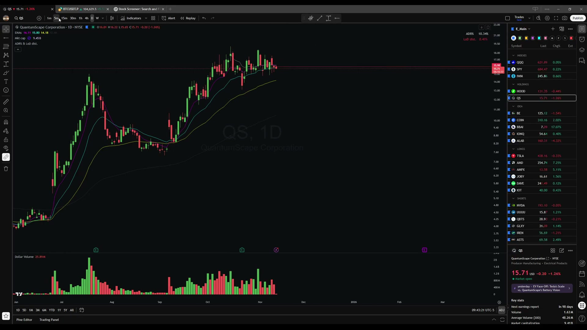

**第二张图（日线）：** 解释他为何研究QS，而不是只因一根5分钟红K就做空。同一价格区域换周期后角色不同：15.98附近的水平线并不会因为画在日线上就变成日线止损方法。

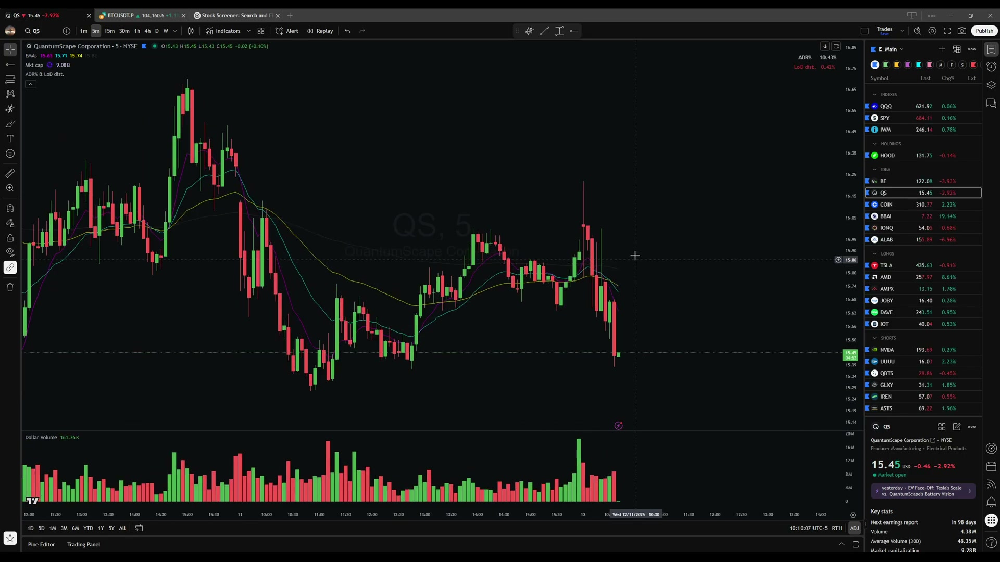

**第三张图：** 中右部先有向上冲高、随后再向下。其口述为止损约15.98，某根K高到16.00，差两美分被扫出；后来继续跌不属于已退出仓位的利润。他直接承认这是偏爱紧止损的代价。

**宽紧两案怎样比较：** 自述紧止损约1.3%，若改用当日高点约2.8%，同等账户风险下数量约乘1.3/2.8，约46.4%。不是亏后把止损上移而保留原股数，那会增大风险。原实际账户风险低于0.5%，不能把其口述百分比拼成完整精确订单流水。

**练习问题：** 假设10000美元账户、预算40美元、做空价15.80；止损15.98最多222股，计划亏39.96；若预先选16.24止损，最多90股，计划亏39.60。价格先到16.00再跌到15.20，紧方案实际已止损；宽方案可能仍在，但必须用自己的既定退出计盈。这里只演示不同路径，16.24与15.80是教学假设。

### 操作拆解三：SNDK不是“卖掉多头立刻反手空”

**视频原意（D形成过程、B重入）：** 先退出多头；之后观察其相对半导体/存储组较弱；从摆动高点锚定AVWAP；某次反弹很强时没有硬空；后来弱收盘，再计划下一交易日有反弹才尝试。这里“weak close”是收得弱，不是“等周线收盘”。

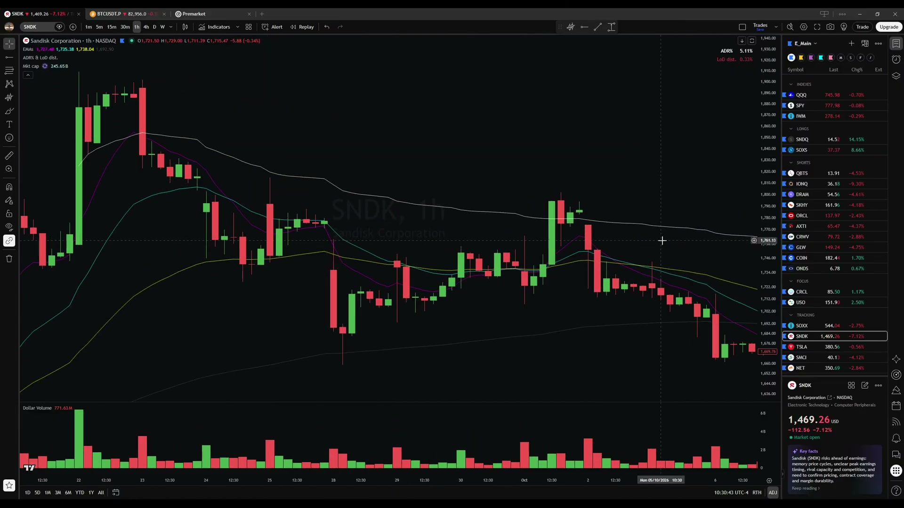

图内中右部反弹触及上方线附近后再次转弱，配合其日线反抽判断。教你学的是顺序：退出旧多头只解决旧单；相对弱势建立新候选；弱收盘是新增信息；下一次反弹才提供较接近阻力的空头位置。

B又谈到一次在小时EMA50附近试空止损，仍继续跟踪，后来价格向日线EMA9反弹甚至越过前日高，再寻找盘中走弱。这解释“继续观察”与“无条件重入”的区别。每次候选止损和实际数量都要重算。后续激进加仓本人不推荐，没有统一倍数，不能改造成教材默认步骤。

### 操作拆解四：急涨后第二次上推失败，与下降趋势反抽有什么区别

CSCO/MSTR历史讲解里，先有抛物线上涨后的首次破坏，再有看似建设性的整理、较高低点或杯柄式恢复，随后尝试上推却失败。**他等的是恢复尝试失败这件新事实，不是因“已经涨太多”就一直提前空。** 某些破坏发生时价格仍在周线EMA9上方，不能要求所有转折都已跌破EMA50才有研究价值。

教学回放要分别保存四张状态：原加速阶段、首次破坏、恢复整理、再次上推失败。只保留最后大跌全图，会失去当时多头为什么看起来合理、空头为什么必须等待的关键信息。若恢复突破真正持续成功，则原空头假设没有确认，不能用更小周期的一次红K强行坚持。

**空间反例：** RKLB虽有盘中下破，下方仍接近日线EMA50与周线EMA9；NVDA例子则因急于建立空头，只等到小时EMA、日线位置并不理想，反复止损。小周期按钮存在，不等于交易位置值得做。此处没有统一“最小几R”门槛，先量出最近支撑再决定是否值得研究。

## 第9课：极端超跌反转做多（Parabolic Long）

### 9.1 怎样与“越跌越买”区分

这类机会依靠恐慌、连续大跌和异常向下延伸后的快速恢复，不要求已经形成普通上升趋势。TQQQ案例中，他在前面的恐慌下跌时就有准备，等待进一步极端下跌，再找盘中反转。机会少，不能每天将普通弱股下跌都命名为同一形态。

### 9.2 视频教到的执行框架

1. **提前有计划：** 写出为什么是异常行情，而非正常小回调。
2. **分清参照与工具：** QQQ是指数ETF参照，TQQQ是实际讨论的杠杆工具，价格距离不能混算。
3. **等反转触发：** 案例使用1分钟转强/突破，而不是低点尚未形成时无限接刀。
4. **明确失败位：** 自述初始止损约2%、参考突破K低点，属该笔案例。
5. **先看反弹目标：** 小时均线与上方阻力，在反弹中结合强度和首次走弱兑现。

假设买入工具50.00、止损49.00，每股风险1.00；预算50美元对应50股。若工具滑点成交50.50而止损不变，每股风险变1.50，数量须相应下降。数字是教学假设，2%不是所有极端反转统一标准。

### 9.3 什么时候不使用

没有异常恐慌背景、没有盘中转强、每次反弹都迅速被卖回、流动性不足以执行，或只因已经大跌而想摊低成本，都不满足上述学习框架。视频里均线偏离百分比还存在转写和参照切换疑点，教程不补出“跌离均线多少就必买”的公式。


### 操作拆解：TQQQ极端反转的准备、触发和兑现

**视频原意（A TQQQ）：** 前面连续出现严重向下缺口/抛售，他提前期待可能再一次极端下探；实际再次大幅向下延伸后，才在盘中用1分钟突破尝试反转。自述初始止损在突破K低附近，约2%；先设定反弹至小时EMA9附近作为目标参照，后来因为反弹很强，没有一到线就全部卖，而是等最初走弱、在附近阻力兑现。这不是普通日线回调的顺趋势买入。

**把计划拆成五格：**

1. **背景格：** 连续极端抛售与异常延伸已经出现。仅有一根普通下跌K，不足以套用本案例。
2. **准备格：** 写下继续下探时观察哪个工具、何种反转触发、哪里认错以及先看哪一层阻力。期待再跌不等于提前无限挂买单。
3. **触发格：** 到位后出现实际分钟转强；如果开盘继续下跌、没有向上突破，则仍未触发。不能用最低点价替代突破成交价。
4. **风险格：** 参考实际买入工具TQQQ的K低、价格和数量；QQQ是其指数ETF参照。口述中均线偏离百分比及工具切换存在转写疑点，不把20%/50%等读数写成统一筛选阈值。
5. **退出格：** 预先标记小时EMA及附近阻力。抵达后强势延续与出现首个走弱，属于不同的新信息。因为他没有公布固定延长算法，练习要事先记录自己采用“到位即退出”还是“到位后等待指定弱化”版本，分别统计。

**教学假设演练：** 买入工具50.00、初始止损49.00，50美元预算50股，目标参照53.00。若在53.00卖25股、另25股在52.50退出，毛利137.50，初始风险50，实际2.75R。最高摸到54.00不代表该单4R。若没有反转、原观察区继续向下，就没有该笔成交。

他自述这类机会很少，不能因单次成功每天寻找一个“足够便宜”的弱股去复制。连续缺口的天数、异常程度及入场过滤，本素材没有给成通用机械标准；本课可练的是准备与执行次序，不能声称已复刻整套筛选系统。

## 第10课：极端上涨反转做空、EP和提前入场

### 10.1 极端上涨后的反转

黄金矿业案例交易的是异常上涨延伸后的回落，价格可能仍在多条均线上方。这与下降趋势首次反抽不同，也与第8课等待第二次上推失败不同。Martin认为矿业股移动比黄金本身更快，并选择相关ETF表达方向。

操作学习顺序是：先标明为何属于极端延伸；选择实际工具；等反转迹象和可限定风险的入口；事前查看回落目标；到支撑或明显下跌延伸时更积极兑现。四视频未给连续上涨天数、涨幅门槛、顶部确认指标和统一专用止损，不应把这一框架伪装成完整机械教程。

案例涉及DUST反向ETF。看空矿业可能通过**买入反向ETF**表达，不等于卖空DUST。若买入反向ETF，订单股数仍按“买入价−工具止损价”算风险，而不是套用底层矿业指数的点数。隔夜跳空也可能使实际损失超过紧止损的计划金额。

### 10.2 EP：先有事件候选，再找价格入口

Martin把EP列为方法集合，并在PL案例使用这个称呼；开盘冲高失败后再转强，出现5分钟入口、相关K低止损和退出取舍。首播扫描也先找EP或突破候选。

因此，在这四视频范围内能落实的步骤是：把有事件/跳空背景的股票列为候选；查看大周期、关键位和可执行空间；等实际价格结构；明确股数与失败位。**事件热度不能替代入口和风险。**

完整EP筛选条件并未教全：催化怎样认证、财报增长门槛、跳空幅度、放量倍数、适用市值、整理长度和统一出场都未完整披露。教程收录其执行思想，但不借其他交易者的数字填空。

### 10.3 提前入场放在什么位置

访谈有未等完整突破/跌破先执行的案例，理由是阻力反应、等确认可能使止损变宽；他也承认含裁量、可能偏离常规。学习阶段将它单独标记，不能把正常确认入口和提前猜测混算。

**教学训练选择：** 先练已确认触发；若研究提前入场，另建样本，记录当时看到了什么、止损在哪里、为何接受缺少确认。这个训练顺序是整理建议，不是Martin宣布的强制课程。


### 操作拆解一：矿业极端反转，先确定你在买什么

**视频原意：** 他认为黄金矿业移动更快，且直接交易全天候商品的时段参照较困扰，因此选择相关ETF表达方向。讨论图表可能是矿业或原油/黄金等参照，订单却可能是反向ETF。**看空矿业、买入反向ETF、直接卖空矿业ETF，是三种需要分别计算的订单关系。**

本例应写成“底层矿业上涨异常延伸 → 寻找回落机会 → 使用DUST表达偏空 → 按DUST买入价格和下方止损算风险”。不得把底层图的顶部美元价格直接填进DUST订单，更不能误写卖空DUST来表达同样的看空判断。

他在后续缺口/明显下跌延伸中兑现，接近底层支撑时不愿继续承受反弹。自述即便止损较紧仍可能出现隔夜不利缺口；这解释为什么工具、仓位和隔夜风险要独立于图形入口检查。原视频没有专门公布矿业极端空头的完整确认/止损公式，教材保留为案例方法，不声称可以一键机械复制。

### 操作拆解二：PL的EP交易，开盘假突破后怎样重新等

**视频原意：** PL开盘向上后回落，首次开盘区间突破出现假突破；他后来用5分钟K高突破入场，止损参考突破K低，自述约2.3%、低于2.5%。他称为EP交易，但并不是“第一下跳空就买”。

**操作练习的观察次序：** 先记录事件/跳空候选 → 标大周期及开盘区间 → 首次上冲失败时不假装原突破一直有效 → 等后续新的分钟结构 → 记录参考K、触发价、止损及实际成交。四视频没有给EP催化的完整筛选门槛，事件真实性核对应另外完成。

**与回调的区别：** 相同5分钟前K高按钮可以服务EP，也可服务EMA回调；分类看背景及所等的位置，不能只看按钮。若等的是事件后重新定价，就是EP候选；若等的是趋势支撑回测，则记录回调。允许案例同时有多个特征，但训练统计应事先确定主要形态。

他对PL入口较满意，却承认全仓强势兑现后又有上涨。这只能说明退出取舍仍有改进空间，不能用事后最高价把原退出判成唯一错误，也不能据此教“EP永不分批”。

### 操作拆解三：提前入场能学到什么，不能直接抄什么

提前空头例子中，他在AVWAP附近看到阻力反应，因等下破后止损可能更宽，尝试未等正式下破先入；他承认这有裁量、可能偏离常规，但强调入场前仍明确止损。**确定止损并不能把未确认入口变成已确认入口。**

第一轮训练只练可说明的触发。若专门研究提前入场，另开样本，必须记录：当时已经出现了什么阻力反应、正式触发还缺什么、提前价格改善多少、止损设哪里、后来没有下破怎么办。不能拿正常突破单的成功率给这类提前单背书。四视频未给提前入场的统一判断标准，不能要求读者凭“高确信”操作。

## 第11课：每笔下单前如何算风险

### 11.1 三个百分比，三件不同的事

止损距离是工具价格变化；账户风险是预计亏损占权益；仓位比例是投入或名义金额占权益。买入20.00、止损19.50，止损2.5%；若账户10,000、只愿计划亏50，数量100股、仓位2000，即20%仓位、0.5%账户风险。

视频里的约0.5%是常用/平均参考，交易不顺会降，首播当时约0.3%～0.4%；有利润垫和更强确信时可能增加。不是所有订单固定0.5%，也不是教程建议每个人照搬该预算。

### 11.2 正确计算顺序

```text
先定账户权益与本笔风险预算
计划风险金额 = 当前权益 × 本笔风险比例
做多每股风险 = 预计实际入场价 − 初始止损价
直接卖空每股风险 = 初始止损价 − 预计卖空入场价
理论数量 = 计划风险金额 ÷ 每股风险
按最小单位向下取整，再检查资金、保证金和流动性
仓位金额 = 数量 × 入场价
```

入场价等于止损价时，不能算“无限股数”；这意味着计划没有有效价格风险距离。止损在错误方向也要重写计划。算完不满足账户/工具条件，就减数量或放弃。

### 11.3 视频中的止损距离约束怎么理解

| 层次 | 视频内容 | 实际使用要点 |
|---|---|---|
| 波动尺度 | 小于个股ADR的50% | ADR%与止损%用相同量纲，记录计算口径 |
| 所述最大距离 | 5% | 不是目标值，更不是每笔都开到5% |
| 当时偏好 | 多数更紧，很少超过约2.5%～3% | 不代表紧到任何程度都更好 |

**教学假设：** ADR=6%，其50%为3%。止损2%可通过这一项检查；止损4%虽然低于5%，仍不满足该ADR尺度约束。反之，满足距离约束但大周期位置很差，也不能凭数字通过就交易。

ADR窗口视频未完整披露，不能声称上述检查等于精确复现他的指标。对高ADR、小市值工具，他也会缩小仓位；结构、波动和执行条件要一起看。

**图解：访谈交易风格页。** 页面列出波段/趋势跟随、突破/EP/抛物线/回调，风险约0.5%并随资金曲线及市场变化，止损小于ADR的50%、所述最大5%。35%仓位限制被划掉，不能读为现行硬上限。账户统计仅为视频展示，教程不独立认证。


### 11.4 为什么止损更紧不等于账户更安全

同一风险预算，止损更紧会推导更大数量。一旦隔夜跳空或流动性不足，真实损失可能远超这条小距离。QS展示容易被扫出的成本，访谈跳空亏损展示计划止损不能保证最大亏损。

视频多数单股仓位约25%～30%，小微盘约20%或更低，慢工具有时更大；旧35%限制已不再严格使用。这些是他的经验，不能用作所有账户统一上限。若公式推导出过大仓位，可以独立加仓位约束，但应标明是自己的约束。

### 11.5 组合不能只看净多空

假设多头名义金额相当于权益80%，空头名义金额60%，净多头20%，总名义敞口140%。净额小不代表两边都安全；还要看各仓止损风险、相关题材、隔夜跳空和执行负荷。数字只是教学算术。

Martin承认保证金下的大额多空共存让自己难以管理，导致无明确技术理由过早卖出PLTR。应记录管理压力，而不是推导“他的体系禁止多空同持”。同题材六笔各0.5%新仓初始计划风险，简单合计为3%，并非视频规定组合上限。

### 11.6 重入和加仓不能抹掉前次风险

每一次重入重新算实际入口、止损、股数；同一交易想法合计前面亏损。假设第一次亏50、第二次赚150，同想法净赚100，不是只展示最后一次150。若各次预算不同，不能直接相加不同分母的R。

加仓前也要写新增数量与新风险。已有浮盈不是无风险资金，不能因“利润垫够厚”省略新增订单的失败位。SNDK的激进加仓本人不推荐；四视频没有统一加仓倍数、日内次数或连亏停手数。


### 操作拆解：把止损选择变成真正可下的数量

**视频原意（A仓位演算）：** 先量触发价到当日低点的距离，觉得约3%偏宽时，再比较相关K低约2.5%的方案；然后用账户计划风险算仓位。例子中10000美元、0.5%风险是50美元；2.5%价格止损对应2000美元名义仓位。要区分“美元÷美元每股风险得到股数”和“美元÷止损百分比得到名义金额”。

**模拟下单前逐项填，而不是只背公式：**

| 字段 | 示例（教学假设） | 检查点 |
|---|---:|---|
| 当前权益 | 10000美元 | 不沿用账户已变化前的旧权益 |
| 本次预算 | 0.4%=40美元 | 是本次训练预算，不等于他每笔固定0.4% |
| 预计成交价 | 20.12 | 考虑触发后实际能成交的位置 |
| 初始失效价 | 19.90 | 先有结构，才算距离 |
| 每股价格风险 | 0.22 | 做多入场减止损；直接空头反过来 |
| 整股数上限 | 181股 | 40/0.22向下取整，价格风险39.82美元 |
| 名义金额 | 3641.72美元 | 不是风险金额；还需看资金/仓位约束 |
| 实际成交 | 假设20.18 | 同样止损下每股变0.28，40美元预算只对应142股 |

预计与实际差0.06美元很小，但对0.22美元紧止损并不小。若原181股全部在20.18成交，价格风险为50.68美元，超过原40美元预算。**练习时先设可接受成交范围；超出范围且未成交，就取消并重算。** 若已经成交，则如实记录偏差并按已有风险管理安排处理，不篡改初始价格或假设总能在同价减回。

若预算要包含费用和滑点预留，先从总预算减去预留再算股数。例如总40美元、预留4美元，按0.22风险最多163股，价格风险35.86美元。预留额由自己的交易成本决定，视频没有给统一4美元。

### 紧止损下怎样看组合与跳空

同板块多只同时买入，各自止损小，不代表组合风险独立。教学上将同题材仓位放在一起，合计初始计划风险，同时记录总名义敞口。多头80%、空头60%，净多20%但总140%，不能只报告净额来判断管理负荷。

小微盘他会缩仓，是因不利消息可能造成很大缺口。**教学假设：** 10000美元账户持有3000美元某股，隔夜向下跳空20%，忽略其他变动时约损失600美元即账户6%；不是计划0.5%止损就自动封顶。直接空头还需考虑相反方向缺口及可借券问题，反向ETF又是另一种工具，三者不混算。

### 操作类型补充：触发价、限价和止损价不是同一个字段

以下是**外部执行知识**，用于把视频信号落到平台订单，不是Martin披露的下单习惯。停止单触发后通常转为市价单，成交可能偏离触发价；停止限价单触发后成为限价单，可能无法成交。不能既假定一定成交，又假定永远不滑点。[SEC投资者订单说明](https://www.investor.gov/introduction-investing/general-resources/news-alerts/alerts-bulletins/investor-bulletins-15)。

在模拟平台分别核对：买入触发还是保护性卖出；触发按成交价还是报价；是否支持所需时段；单子何时到期；部分成交后止损数量是否跟随。四视频没有完整披露这些设置，教材不会给所有券商一套通用点击路径。新手先在模拟环境用1股验证订单行为，再练完整风险计算；这是教学安排，不是其原话。

### 11.7 参数冲突怎样处理：不把解说数字升级为统一硬规则

**先看证据身份，再选自己的模拟假设。** E是第三方压缩总结；A包含本人对早期做法的修订。以下差异不会靠把两个数字取平均来解决。

| 项目 | E怎样概括 | A～D与本教程的处理 | 实操记录办法 |
|---|---|---|---|
| 单笔账户风险 | 基准0.5%，随环境/表现调整 | 与A基本一致，但不是每笔必须用满 | 写本次预算金额及选择理由 |
| 单股比例 | 大盘流动股最高35%，小微盘25～30% | A明确说35%已非严格上限，常见25～30%，小微盘20%或以下，慢工具可能更大 | 采用自己预设限制并注明；不可写成最新统一35% |
| 日低太远 | 超过5%改用5分钟入场K低 | A另说常见较紧范围、ADR关系与视情况选K低，非统一等到5%才改 | 比较结构、噪声、数量；没有合理近止损就取消 |
| 强势减仓 | 超3R、每次10～15%；仓位涨过35%等 | A有3R或5R、约15%例子；比例与环境有关 | 入场前注明计划，盘后按实际成交算整单R |
| 趋势跟踪 | 主要EMA9，强趋势早入可21/50 | 可作情境框架，不能亏损后随意换慢线扩大容忍 | 事前写周期/线/触发方式，改变时记录新依据 |

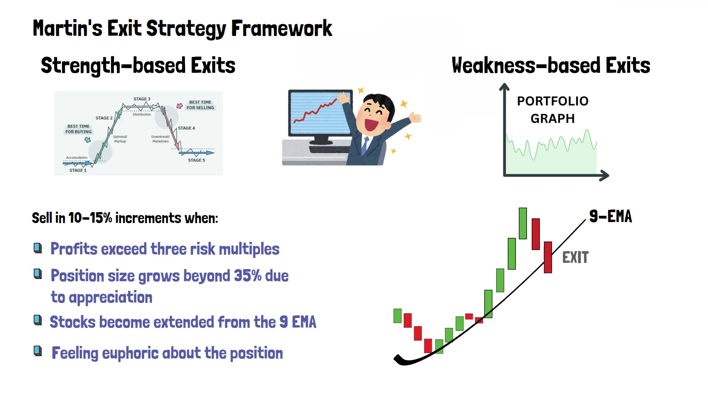

**图解：** 画面把10～15%、35%、3R和EMA退出压成一页。它方便检查遗漏，却抹平了本人访谈中的版本变化和自由裁量。使用时逐项对照上表，不能把整页截图当统一订单程序。E中的“情绪很兴奋”可以提示检查敞口与计划，不是能独立决定卖出价的技术信号。

### 11.8 胜率、盈亏比与紧止损：先算清楚，再谈优势

**教学数学，不是绩效认证。** 若每次输1R、赢5R，且每次初始风险金额相同，不计成本，期望R为`p×5−(1−p)`；打平胜率是`1/(5+1)=16.67%`。E的平均赚15%、亏3%比值是5，但当各单仓位/风险不同，百分比均值不能直接替代等风险账户的真实R序列。

E同时提104笔赢、319笔亏、胜率23%。仅按这两类计数，104÷423≈24.59%，并非23%；可能存在其他分类、样本或四舍五入口径，现视频未解释。保留“统计口径待核”，不以这组数字证明策略实盘期望。

**紧止损的实际含义：** 固定25%价格涨幅，3%初始止损对应约8.33R，1.5%对应约16.67R；固定50%涨幅则约16.67R与33.33R。关系为`R=价格涨幅/初始止损幅度`，是固定涨幅下的反比关系，不是收益必然指数增长。更紧止损可能多次被扫出，并提高相同预算下的数量和成交难度。比较两套方案必须同时记录胜率、重入次数、费用、滑点和累计损失，不能只比较同一张大牛股图最后能达到多少R。

## 第12课：买进去以后，怎样持有和退出

### 12.1 初始止损与获利管理分开

初始止损回答“我错了怎么办”，分批和趋势跟踪回答“我对了怎样处理”。不要入场后靠想象更大的趋势，一直放远止损。视频有裁量，但没有教取消风险边界。

获利后先重看三件事：市场/板块是否仍支持这段趋势；价格是否已明显延伸或接近关键位；近期自身交易是否顺利、能否承受浮盈回吐。答案不同，处理可不同。

### 12.2 三种出场思路

| 思路 | 怎么操作 | 视频里的边界 |
|---|---|---|
| 分批兑现 | 按计划卖一部分，剩余另设管理依据 | 常在3R或5R附近，不是固定3R后必经5R阶梯 |
| 延伸/结构兑现 | 多头遇上方阻力或明显上冲延伸减仓；空头接近下方支撑回补 | 可能提前，后面继续原方向运行是代价 |
| 趋势跟踪 | 跟随指定周期EMA或结构，直到所选退出条件出现 | EMA9有实例，不是所有工具唯一退出线 |

Martin没有严格统一卖出规则。强市、组合有厚利润垫时，可能不分批而跟踪全仓；BBAI提到约15%部分退出，不能推广为每笔固定比例。

### 12.3 保本止损没有统一R按钮

空头更新中，他直接说要看情境。若认为板块处在潜在下跌初期、后续空间大，会愿意让浮盈回撤，部分空头不立即移到保本；若缺乏多周上涨信心，某些多头在EMA9及前K低破坏时就更早退出。自身资金曲线顺利时，愿意留更多仓位；回撤后，更愿兑现和保护。

**教学步骤：** 每次想移动止损时，写“新信息—调整目的—新止损价—剩余风险”。例如：“板块恢复，预计空头继续下跌的概率下降；因此回补一部分，余仓止损移到某结构上方。”这是格式示范，不是推荐某个动作。

做多保本通常把止损从入场下方向上移；直接卖空通常把止损从入场上方向下移。费用和滑点存在时，入场价也不一定是真正净保本价。没有统一的到2R、3R必保本规则。

### 12.4 收盘确认与盘中硬止损必须选清楚

访谈有首次收盘跌破日线EMA9退出，也有因香港时区无法总盯收盘，改用EMA9下方相关K低附近硬止损的处理。

收盘方案需要等所需K线结束后才知道信号，不能在回测中用收盘结果换取更早成交。硬止损在价格触达时执行，可能被下影扫走，不能盘后说“其实我想等收盘”。写计划时明确周期、信号时间和执行时间。

### 12.5 空头持仓时间取决于环境

QQQ上行时，他对QUBT等更倾向快速波段，两三天回补小利润；潜在板块下跌初期，可能留空间捕捉更大下行。直播DRAM则展示：仍偏空，但下跌延伸、靠近缺口/旧低点/周线支撑时，先回补一部分防反弹。

所以“看空”与“当前回补”并不矛盾。未来可能不再给反抽入口，是提前兑现的成本。不能把这套裁量缩成“空头第三天一律平仓”。

### 12.6 算完整交易的实际R

**教学假设：** 100股买20.00，初始止损19.50，初始风险50。50股在21.50卖出，盈利75；剩余50股在25.00卖出，盈利250；总毛利325，等于6.5R。最高股价对应10R，不等于整笔赚10R。若总费用5，净利润320，为6.4R。

若同想法前面还亏50，同想法净赚270；用事先固定50美元想法风险单位衡量为5.4R。单位应提前约定，不能为了显得高收益临时选最小分母。


### 操作拆解：持仓管理前先选择“我在管理哪一种收益”

**视频原意（A卖出段，D保本问答，B空头回补）：** 他没有统一严格卖出算法。常在3R或5R附近分批，小时明显延伸时也会兑现；市场很强、其他仓位有利润垫时可能全仓跟随。BBAI讲到每次约15%的减仓及首次收盘低于EMA9退出，但没有把每个标的都规定成同一阶梯。

**教学整理的三份管理预案，交易前选主要版本：**

| 预案 | 提前写什么 | 持仓时看什么 | 接受什么代价 |
|---|---|---|---|
| 结构/延伸兑现 | 哪个周期的阻力/支撑是第一观察目标，准备减多少 | 到位后是继续强推还是出现明确反转 | 卖完仍可能继续原方向 |
| 指定周期趋势跟踪 | 用日线收盘低于EMA9，还是某已完成K低失守等条件 | 该条件是否真实出现，是否需要等收盘 | 会交回部分浮盈，可能遇缺口 |
| 分批与余仓跟踪 | 第一批条件/数量、余仓跟踪依据 | 每次真实成交和剩余数量 | 组合实际R低于最高未实现R |

不能在价格回落时突然把“小时快速反弹单”解释成“日线长期趋势单”，借切大周期逃避原失效。也不能一涨就换成最敏感的小周期，以“信号变了”掩饰没按计划持有。

### 保本之前检查两件事，而非盯着固定R

D直接回答保本取决于市场阶段与自身资金曲线。对他认为潜在下跌初期的空头，愿意牺牲浮盈留更多下行空间；对没有多周上涨信心的多头，可能在EMA9和前K低破坏时较早退出。顺利时更愿持有，回撤后更愿兑现与保护。**这只是他的裁量考虑，不提供预测市场阶段必然正确的公式。**

教学日志用四行记录一次调整：新增事实是什么；调整目的是什么；旧止损/新止损与数量；调整后仍可能损失多少。只写“怕利润没了”不能解释结构变化，但应如实登记情绪，不把情绪伪造成图表信号。

### 收盘确认与硬止损的两条实操路线

- **收盘路线（视频有实例）：** 先指定日线EMA9退出依据，等该日结束再判定是否收在其下。盘中穿线后收回，不等于已经触发这个收盘条件；回测也不能拿最后收盘结果假设自己盘中更早卖出。
- **硬止损路线（视频有实例）：** 因香港时区难以一直盯收盘，他会选择EMA9下方的相关K低，留一些下探空间。此时触价就可能退出，即使后来收回也不能改成“其实我是等收盘”。给多大缓冲没有统一披露。

FUTU例子体现这两条路线：盘中较早兑现，与按K低设置硬止损，成交价格可能不同；不能用一条路线的风险承诺配另一条路线的事后收益。

### 空头回补：看空观点没有消失，也可以减仓

B里DRAM接近未补缺口、旧低点支撑，指数也在潜在支撑附近；尽管仍偏空，他考虑先回补一部分，等可能的反弹再找机会。**关键代价他自己也讲了：反弹未必出现，即使出现也可能错过重入。** 所以不能把“先回补、后原位空回”当作无成本提高收益的技巧。

C里QQQ仍向上时，QUBT空头更倾向两三天快速处理；D里若认为下跌初期，则可能留部分空头。一个是逆大盘做快速波段，一个是尝试捕捉新下跌阶段，不应合并成固定持有天数。

B关于反弹后进一步回补的问答里，分钟周期在机器转写中有歧义，不能明确锁成“16分钟EMA9”。可确认的是等待较强收复、可能回补部分，仍保留其是否只是反弹的判断；不将含混周期写成系统参数。

### 分批后的数量核对

**教学假设：** 100股，初始每股风险0.50，先卖30股盈利1.50/股，剩70股止损亏0.50/股：总毛利45-35=10美元，实际0.2R。第一批是3R兑现，不表示整笔已赚3R。每次部分成交后，要核对剩余止损数量与剩余持仓一致；若平台没有自动联动，错误数量可能导致额外反向仓位，这是执行检查而非视频交易规则。

### 12.7 持仓上涨后：仓位占比变了，初始R不能跟着重设

**E补充的观察点：** 盈利使单股占账户权益的比重漂移，可能触发敞口复核。这不等于采用它的35%统一阈值。每天至少区分三个数：当前名义市值、当前总权益、最初承担的风险金额。

**教学假设：** 账户10000美元，无杠杆无其他变化；用3000买100股、每股30，初始止损29.50。最初风险50美元，仓位30%。涨到45时，持仓4500，现金7000，总权益11500，仓位约39.13%，不是4500÷旧权益10000的45%。价格盈利1500相当30R；以后把止损上移也仍用原50算该笔最终R。

**执行步骤（教学整理）：** 更新权益和市值→查自己预设的集中度与事件风险→检查价格离跟踪线/阻力是否延伸→按既定强势减仓或趋势退出计划处理→记录卖出数量、价格和余仓规则。若卖20股于45，无费用时权益仍11500，余仓3600，占31.30%；现金增加而卖出瞬间总权益不因换成现金凭空上升。E的兴奋感只触发复核，不允许临时放宽亏损单止损。

## 第13课：把视频案例变成可独立复盘的记录

### 13.1 AMPX：先准备位置，后等开盘触发

**已知背景：** 值得关注的股票，盘前已估计约7.45～7.50支撑，结合日线均线与AVWAP。**发生过程：** 开盘回落到所关注的位置，再用1分钟转强/突破触发。**学到的动作：** 开盘前先写支撑理由和条件；不是价格一涨才去补理由。**复盘边界：** 缺少完整分钟/订单细节时，只重建已知逻辑，不填造实际盈亏。

练习问题：如果没有回落而直接上涨，你的原计划是否允许追价？若不允许，记录“未给入口”。如果回落后持续下跌，不能因为盘前选中就继续坚持。

### 13.2 USO：失败后怎样重新准备

**背景：** 原油日线收复和周线支撑值得研究。**前次问题：** 某次USO尝试止损，后面第一次向上突破又错过。**新信息：** 所讨论K线收得较强、回到均线上方。**再行动：** 等向15分钟EMA9回踩后买入。**核心：** 新结构支持新的尝试，不能用旧观点直接重复下单。

练习问题：如果第二次没有回踩怎么办？允许未成交。若要改成另一种入口，必须独立重写风险，而不是在追价后将其解释为“确认后回踩”。

### 13.3 QS：正确方向与亏损结果可以同时存在

**背景和按钮：** 多周期下降/阻力参照，加5分钟跌破。**失败：** 约15.98止损被约16.00触及后，行情继续向下。**错误推论：** “下次一定把止损放到16.01。”**正确复盘问题：** 原止损在当时是否合理，较宽结构会减少多少股数，两类方案的长期样本怎样？

练习只记录已经成交的一段损益。止损后行情再跌，不归入自己的持仓收益；也不由这一例得出紧止损必错或宽止损必对。

### 13.4 SNDK：证据叠加与激进操作分开

**先有退出：** 原多头结构被破坏。**再有研究：** 相对板块弱、摆动高点AVWAP、弱收盘。**等待与按钮：** 下一交易日反弹进入下降日线/小时阻力，再找转弱。**额外行为：** 后续激进加仓，本人不推荐。

把前面能解释的选股、定位、触发学清楚；将加仓单独标为裁量行为。不要因为该次结果好，就倒推所有高确信都该加风险。

### 13.5 QBTS与PLTR：过程失误不能改写为策略

QBTS中，他自述在强势中慌张回补、接近日高，意识到失误后约15～30分钟重新入场，合计小损失。它是纠错，不是“上涨时先回补、等固定时间重空”的套路。

PLTR中，他说过早卖出且没有明确技术理由，原因包括同时管理大额保证金多空的心理负荷。复盘要写“执行负荷/方向偏见”，而不是补造一条图表退出理由。

### 13.6 SK hynix：为什么要检查自己选的图

他发现韩国本土周线反弹乏力、受历史高点锚定AVWAP压制，而美国所看图更好看；半导体ETF已经恢复时，这种落后增加了其弱势判断。学习重点是多找一个独立参照，避免漂亮单图遮蔽相对弱势。

这不是两地价格可直接互换。记录代码、交易场所、币种、周期和时段；差异原因在视频里没有完整解释，不补成价差套利模型。

**图解：韩国SK hynix周线。** 代码000660、交易所KRX、周期周线。右侧显示急涨后的回撤与反弹乏力，上方锚定线提供阻力观察。重点是本土图相对板块恢复较弱；不同市场的报价、币种与交易时段不可混为一套订单。


### 13.7 复盘时每笔回答七个问题

访谈还复盘过自述约26%的月度回撤：老仓浮盈回吐，随后过度交易、多空来回切换，新仓缺乏跟随，损失叠加。紧止损仍可能带来很波动的资金曲线。震荡中未到3R/5R就回落，他更倾向减少交易，而非将体系一律改成1R止盈。这个经验应反映在每日风险和交易频率中，不能只学低价入口、忽略连续失效的反馈。

1. 为什么在这天、这个板块、这只工具上研究机会？
2. 大周期的位置是什么？关键位当时已经可知吗？
3. 实际触发是哪根K、哪个区间，而非事后哪根看起来最好？
4. 下单前算了风险和股数吗？实际成交使它变化了吗？
5. 每次退出依据是什么，是否临时改规则？
6. 前面同想法亏损、费用、错过和未成交是否算进去？
7. 亏损是合格尝试，还是计划/执行失误？盈利是否同样可能是不合格交易？


### 案例复盘怎样写得足够具体：六种常见失败要分开

| 类型 | 视频对应事实 | 合格复盘写法 | 不合格写法 |
|---|---|---|---|
| 位置太远 | UPST上涨多周、日线延伸，仅靠小时位置尝试 | 日线背景未满足，分钟信号不应替代 | 止损太紧，方向其实对 |
| 空间不佳 | RKLB下方还有日线/周线支撑 | 触发前已知支撑距离有限 | 做空失败都是庄家洗盘 |
| 执行过早 | NVDA急于空、未等日线理想反抽 | 偏离原等待位置，后面再跌也不洗白入口 | 我提前预测正确 |
| 合格止损也会亏 | C的QS两美分扫出 | 局部止损方案被噪声触达，按事先选择承担 | 下次固定多留两美分 |
| 情绪退出 | D的QBTS慌张回补、稍后重入 | 回补无原计划依据，重入另计风险和成本 | 固定等15～30分钟重空策略 |
| 管理负荷 | D的PLTR因同时管大额多空过早卖 | 名义敞口与心理负荷影响执行 | 图表肯定有一个卖出信号 |

**怎样把一笔案例填成可审阅的记录（教学整理）：**

1. 建立来源与订单身份：例如“C首播QS空单”，不能只写QS。A另有QS多头，不能串成一套多空订单。
2. 保存交易前信息：日线位置、小时阻力、已完成参考K。图右侧已知未来涨跌从训练截图遮掉或在回放中停住。
3. 写出触发与失效结构。若精确成交/股数未披露，填“未披露”，不要用截图大概价拼成交。
4. 按讲述顺序记真实可确认的动作。图表切换、鼠标移动及名单出现，不等于成交。不同直播的同一股票只能作为补充观察，未有完整流水时不串接成全仓生命周期。
5. 用实际已披露结果总结过程。可确认止损，就记止损；只有事后图上百分比，没有订单清单，就不独立认证收益。
6. 写一项下一次能检查的改进，例如“下单前把最近支撑和预期入场距离写出来”，不写“下次必须抓到最低/最高”。

**跨市场比较例：** SK hynix韩国本土周线恢复弱、仍受高点AVWAP压制，而美国图更漂亮，提示不能只挑支持自己观点的图。它没有给出两市场的价格换算与套利订单。记录交易场所、代码、币种及是否同一时段，再比较结构，不直接比较数字大小。

### 13.8 GME：把“最后一批多少R”与“整笔多少R”拆开

**E转述案例，未核实券商订单。** E说2024年5月GME跳空后，用1分钟开盘区间入口，约26.30入、25.47止损；不用当日低点是因为那会需要超过6%的距离。它说明紧K止损是针对特定结构的选择，不能由成功结果倒推所有跳空都该缩止损。

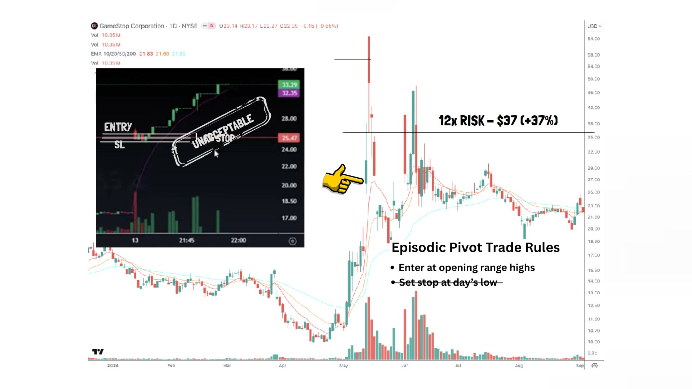

**读图：** 右上小图给ENTRY与SL25.47；主图给第一批附近及抛物线延伸后的剩余退出讨论。第三方图表顶部有EMA10/20/50/200字样，不能当作Martin统一9/21设置的直接证明。箭头属于解说标注，不是成交回报截图。

| 若按E叙述的近似价格演算 | 每股结果 | 相对初始0.83风险 | 对应价格收益 |
|---|---|---|---|
| 26.30买，25.47止损 | 风险0.83 | 1R | 距离约3.16% |
| 第一半在37卖 | 盈利10.70 | 约12.89R | 约40.68% |
| 剩余一半在56卖 | 盈利29.70 | 约35.78R | 约112.93% |
| 两半合计，平均卖价46.50 | 盈利20.20 | **约24.34R** | **约76.81%** |

E同时使用“约12R、37%”和“40R”描述，与上述近似价格不能全部严格吻合。价格可能是图上约数、R也可能另有口径，但现资料不足以恢复真实成交；教程采用明确条件演算，不宣称整笔真实获得40R。

**怎样亲手复盘（教学）：** 先遮住后半段图，确认开盘参考区间已经完成，抄入场与止损；预算50时最多60股，风险49.80。假设30股37退出、30股56退出，毛利1212，除49.80仍为24.34R。若中间有加仓、费用或不同数量，逐笔加入账表再计算；不能用余仓最高R乘全仓。看到后续涨很远只用于复核退出计划，不证明当时必然可以持到那个位置。

### 13.9 COIN：参考标的信号、交易标的风险、自己的退出计划

**E转述与推测分开。** 博主说Bitcoin形成内包日并尝试突破昨日高，Martin通过COIN参与相关走势；买在COIN较低位置/收复附近，讲者原话包含“likely using anchored VWAP”。**AVWAP是讲者对入口的推测，尚不能写成已证实的Martin这笔订单按钮。** 关联关系提供研究方向，不保证COIN同步、同幅度上涨。

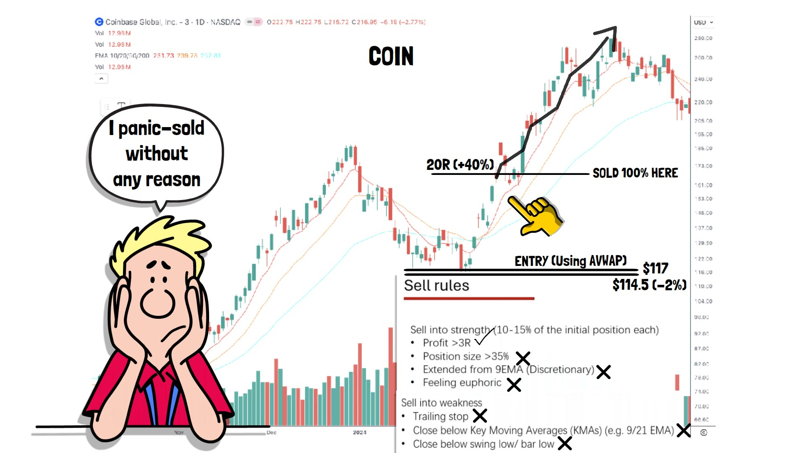

**怎样建立关联交易卡（教学整理）：** 参考对象填Bitcoin，交易对象填COIN及场所；分别记录两者周期、信号时间和边界；写COIN自己的可执行入场/止损/数量；说明若Bitcoin突破失败但COIN尚未破位，按哪个已定条件处理。若只知道Bitcoin涨却不能说明COIN本身哪里失败，就还没有一张完整订单卡。不能把Bitcoin的价格止损代入COIN每股风险公式。

E批评正常整理、仍尊重EMA9时恐慌退出，并提后来再用EP交易COIN；随后又给117/114.50、20R全退及240反事实退出的叙述。**多笔交易的时间及价格归属并不完整，不能串成一笔已核实生命周期。** 可吸收的教训是：非标准入口更要预先写退出依据；相关标的走强并不免除本股止损和情绪纪律。

**独立收益演算，非新增真实成交结论：** 若117买、114.50初始止损，每股风险2.50，距离约2.14%。20R对应167，涨幅约42.74%；240对应49.20R、约105.13%。假设一半167、一半240，平均203.50，整笔34.60R、约73.93%，不是全仓105%。E的“40%”“105%”是不同退出情境下的近似价格涨幅，不能混成实际账户收益。

**复盘检查：** 正常整理是否已触及事先定义的退出条件？若没有，提前卖的理由是环境变化、风险变化，还是单纯害怕盈利回吐？分别记录；后续上涨不会自动证明早退必错，真正要检查的是当时信息与已定计划。

### 13.10 AMD：分析股票和交易杠杆ETP必须使用各自订单字段

E展示的标题是“Leverage Shares 2X Long AMD Daily ETP”，讨论底部收复均线、昨日高与小时高接近、日低止损，以及后来未预先知道的跳空。**这是杠杆ETP案例；不可把它的价格、涨幅与A中的AMD股票叙述直接拼成同一订单。** 本段不推定具体产品代码、交易所权限或长期跟踪结果。

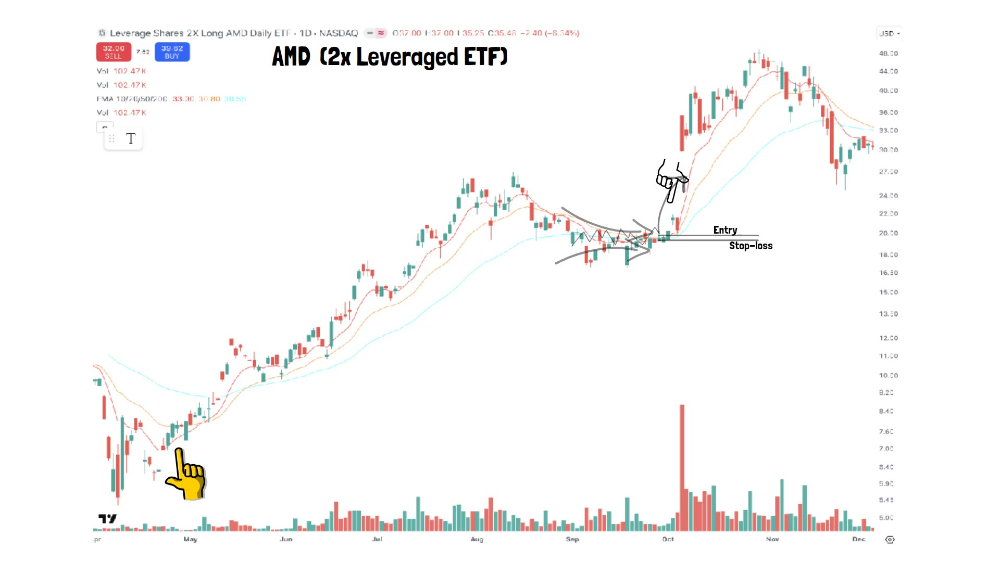

**图解与操作记录：** 日线提供转强背景；“昨日高”和“小时高”分别来自什么已完成区间，要各写一次。若研究正股却下单衍生工具，数量用实际下单工具的入场和止损计算，并注明汇率、价差、交易时段及产品机制待核。正股止损0.50不能直接充当ETP每份风险0.50。后来的新闻跳空是事后结果，不是入场时必有的收益条件；未核实产品机制前仅作图形回放，不根据“2倍”推算每段实际盈利。

## 第14课：将这些方法用于A股时改什么

四视频的盘中执行主要来自美股。普通A股新买股份当日不能卖出，失败后立即止损/重入的顺序不能原样复制。上交所交易规则规定交收前不得卖出，并列有回转交易例外；这是市场制度，不是Martin的参数。[上交所交易规则](https://www.sse.com.cn/lawandrules/sselawsrules2025/trade/universal/c/c_20260424_10816492.shtml)。

| 原视频做法 | 普通A股研究中怎样处理 |
|---|---|
| 当天买入后盘中硬止损 | 模拟无法当日退出的新仓，计入次日跳空、跌停、停牌和未成交 |
| 同日止损后多次重入 | 不能假装可按美股流水执行；重新定义可交易时间和已有持仓 |
| 直接卖空弱股 | 普通做多账户不能将其当可执行订单；可作为规避弱股的研究线索 |
| 杠杆/反向ETF表达方向 | 单独核验工具、权限和收益结构，不套用底层价格算股数 |
| 日线确认、次日入场 | 可作为独立研究版本，但新买股份仍受当日退出限制 |

可保留的是强弱比较、多周期位置、首次回测、明确触发、风险计算与复盘。不可声称“改成日线就消除T+1风险”。直接卖空潜在亏损理论上无上限，紧止损也不能保证封顶。[SEC说明](https://www.investor.gov/introduction-investing/general-resources/news-alerts/alerts-bulletins/investor-bulletins-51)。

TQQQ目标为指数单日约3倍，DUST为矿业指数单日约反向2倍，不是跨日累计固定倍数；这来自发行人产品说明。[ProShares TQQQ](https://www.proshares.com/our-etfs/leveraged-and-inverse/tqqq)、[Direxion DUST](https://www.direxion.com/product/daily-gold-miners-bull-bear-2x-etfs)。

原草案ATR(5)/ATR(20)<0.85、振幅收缩0.8、20/60/120日阈值、成交额1亿元、100分评分和固定分批比例，都应作为独立研究假设。它们不因本教程写得详细，就升级成视频认证规则。


### 操作拆解：普通A股练习要先改“退出能否执行”

四视频的盘中策略建立在可当日退出、止损后再尝试等执行习惯上。上交所现行规则3.1.4规定买入证券交收前不得卖出，回转交易另有例外；交易品种不能一概而论。[上交所2026年交易规则](https://www.sse.com.cn/lawandrules/sselawsrules2025/trade/universal/c/c_20260424_10816492.shtml)。

**教学对照：** 同一份第15课分钟数据，在可日内退出的模拟里触发后跌到止损可以记录退出；如果模拟普通A股当天新买股，则不能仍以该价当天卖出计算亏损。应写“原结构已失效，但执行受限”，继续记录到实际允许卖出的时刻及可成交报价。把日内失效判断与实际退出价格分成两列。

有此前持仓时也不能笼统说“有底仓就能复制”：先核对可卖数量和当日新买数量，记录这次订单增加的是哪一部分风险。四视频没有教完整A股做T制度，本教程不借此拼一套他的A股方法。

**普通做多账户怎样利用空头课：** 用来识别不宜做多的弱势、过滤反弹不过阻力的候选；实际卖空或反向产品属于另一种权限与工具，不把美股做空按钮直接抄进普通A股订单。

**独立研究版本应写哪些改变：** 日内触发是否改成日线收盘确认；次日开盘若跳过计划价是否取消；新买股最早何时能退出；跌停/停牌/缺口如何计入未成交和损失。没有确定这些规则，就只能学习图形逻辑，不能把结果称作已验证的A股交易系统。

## 第15课：每日操作表与回放练习

### 15.1 每天按这个顺序完成一张表

| 阶段 | 实际做什么 | 未满足时怎样处理 |
|---|---|---|
| 盘前 | 指数、板块、自身反馈各写一句；检查原持仓 | 不清楚时减少参与，不强行选方向 |
| 选候选 | 扫描和看图，区分强势、弱势与今日重点 | 有代码无结构，不进入下单计划 |
| 定位置 | 周/日/小时关键位，写锚点和理由 | 不能解释位置，继续观察 |
| 选方法 | 回调、突破、U&R、趋势空头或极端反转 | 混淆形态时先不下单 |
| 等触发 | 选周期，标指定K高低/开盘区间/确认回踩 | 不触发就没有订单 |
| 算风险 | 实际工具的入场、止损、股数、资金条件 | 距离或数量不合适，缩小或放弃 |
| 持仓 | 按第12课选择的依据管理 | 不因噪声或社交媒体随意改方案 |
| 重入 | 检查新结构，累计同想法损益 | 只有不甘心，不构成新入口 |
| 复盘 | 过程与盈亏分开，检查近期跟随 | 连续失效时减少交易而非强行补收益 |

访谈提到常在开盘前45～60分钟准备，但这不是所有人必须采用的作息。上表是一份教学整理工作单。

### 15.2 可直接复制的订单计划

```text
日期 / 市场 / 代码 / 实际下单工具：
参考图表工具（若与订单不同）：
市场趋势、板块表现、自身最近反馈：
主要形态 / 执行触发：
周线位置 / 日线位置 / 小时图空间：
支撑或阻力区域及理由：
AVWAP锚点日期、理由、何时可知：
执行周期 / 指定触发K或开盘区间：
等待什么 / 什么情况取消：
预计实际成交价 / 初始止损 / 每股风险：
当前权益 / 本笔风险预算 / 理论数量 / 实际数量：
止损距离% / ADR口径 / 仓位金额与比例：
同题材风险 / 多空总敞口 / 资金或借券条件：
退出依据 / 是否分批 / 是否采用收盘确认：
何时重新评估保本，依据什么新信息：
同想法编号 / 第几次尝试 / 前次损益：
实际入场、每次退出、数量、原因、费用：
净损益 / 初始风险金额 / 实际R：
是否按计划 / 失误还是合格失败 / 下一步：
```

### 15.3 第一轮只练一种入口

**教学训练方案，次数不是Martin规定。** 先选第4课“支撑反转后前K高触发”，逐根回放至少10个候选，不只挑后来上涨的图。每个候选都记录成交、未触发、取消或错过。

暂停在触发前写计划，再放下一根；一旦写了关键位、止损与退出依据，不看未来后重画。出现真实新信息可以调整，但必须记调整时间。先检查是否识别对位置、算对风险、遵守计划，再看样本盈亏。

第二轮另取样本练第5课确认后回踩，分别统计，比较未成交比例、平均损失、跟随质量与实际R。再研究其他形态，不用混合所有盈利证明“回调法有效”。少量练习不等于统计验证。

回放数据必须支持所练触发：只看日线无法核实1分钟订单；同根K线同时穿过入场与止损，只有高低收开也未必能知道先后。将这类订单标为路径不明，查更细数据或预先规定保守处理，不能总选对自己有利的成交顺序。单独记录滑点、未成交和费用；这属于整理者的验证方法。

### 15.4 四道自测题与答案

**题1：** 账户20,000美元，预算0.3%，买入40.20、止损39.60，整股数量多少？  
**答案：** 风险60，每股0.60，100股；仓位4020，权益20.1%，止损约1.49%。费用另计。

**题2：** 原计划买20.00、止损19.60、预算50，股价飞到20.20才成交；还能买125股吗？  
**答案：** 原125股按0.40风险计算；现在每股0.60，125股风险75。若仍预算50，整股不超过83股，或放弃失去理想位置的入口。

**题3：** 股票碰下降EMA21后出现5分钟红K，就可以做空吗？  
**答案：** 不足。先看大周期/相对弱势、阻力是否有效、指定转弱触发、下方支撑空间和可执行风险。RDDT表明碰均线后仍可能恢复强势。

**题4：** 100股买20、初始止损19.50；30股在21.50卖、70股在19.50止损，最高到过22。整笔多少R？  
**答案：** 第一批盈利45，余仓亏35，毛利10；初始风险50，整笔0.2R，未计费用。最高4R不等于真实赚4R。

### 15.5 什么才算这一轮学会了

你能在未看未来时说明形态、区域与触发；能明确不交易的条件；能用实际工具和实际价格算股数；能解释退出；能承认错过、合格失败与操作失误；能把未披露参数留空并标为研究问题。这些能力比记住直播里哪只股票最后涨了多少更接近教程的学习目标。


### 15.6 跟着逐根做：一套完整的模拟训练数据

**以下全部为教学假设，非Martin真实成交，亦非收益预测。** 目的是让你亲手完成判断、等待、触发、下单计算、止损、重入取消与复盘。练习对象假定为允许当日退出的工具；普通A股另按第14课改变执行假设。

**盘前已知：** 模拟账户10000美元，本次风险预算50美元；候选是同组较强股，日线刚转强后的首次回测，支撑观察区19.80～20.00，小时附近也有参照，上方最近阻力20.80。执行周期1分钟；本轮只练“进入观察区后，向上突破紧邻前一根已完成K高”。买入模拟价规则固定为触发高点加0.01；初始止损选择当时日低减0.01。这些数值、缓冲及成交假设只为练习一致性，不是视频参数，也不能用于承诺实际成交。

**怎样练：** 从第一行开始，遮住后面数据。每次只揭开一行；先写状态和候选价，再看答案。若只有OHLC且同根穿入场和止损，则标路径不明，不强行计盈利。

| 行 | 时段 | 开 | 高 | 低 | 收 | 你应记录的状态 |
|---|---|---:|---:|---:|---:|---|
| 1 | 09:30～09:31 | 20.30 | 20.35 | 20.10 | 20.12 | 还没进入支撑区，不因下跌直接买 |
| 2 | 09:31～09:32 | 20.12 | 20.15 | 19.90 | 19.94 | 到区，但仍在下探；参考已完成K高20.15 |
| 3 | 09:32～09:33 | 19.94 | 20.02 | 19.82 | 19.98 | 未突破上一根20.15；形成更低的日低19.82 |
| 4 | 09:33～09:34 | 19.98 | 20.04 | 19.96 | 20.03 | 向上突破上一根20.02；按教学价20.03模拟成交 |
| 5 | 09:34～09:35 | 20.03 | 20.28 | 20.01 | 20.24 | 触发后出现推进，保存原止损，不用未来结果改写 |
| 6 | 09:35～09:36 | 20.24 | 20.32 | 20.14 | 20.18 | 有浮盈回吐，但尚未触达原止损 |

**第4行下单计算：** 入场20.03，日低19.82减0.01得到19.81；每股0.22，最多227股，价格风险49.94，名义金额4546.81。1R价格20.25，3R价格20.69；20.80是原已知阻力，相当约3.5R空间。这里量空间不是宣称最低3.5R才能交易。名义仓位约45.47%，超过其常见单股比例经验；若自己的仓位约束更小，就减少股数，允许低于50美元风险，不为用完预算而加杠杆。

**第6行之后只能选一个分支继续练，不能事后挑最赚钱的：**

| 分支 | 后续新增事实 | 应怎样处理和记账 |
|---|---|---|
| A：有效推进 | 后一根高20.72、低20.16，之后走到20.80附近 | 若预先计划3R卖一部分，按真实模拟成交记录；余仓跟踪依据保持明确 |
| B：止损失败 | 后一根开20.18、高20.20、低19.79、收19.84 | 入场早已在前几根发生，原止损本根触达；按假定19.81退出亏49.94，费用另计 |
| C：支撑反复磨 | 后续几根围绕19.95～20.10，迟迟不离开 | 尚未触及止损不代表一定要立即平，也不能无限加仓；检查原管理预案并记“缺乏跟随” |
| D：实际价格跳过 | 若第4行开始就跳到20.20，无法按20.03成交 | 原成交假设失效，重新算数量与空间，或记录未成交，不能按旧价填日志 |

**分支A的完整盈亏例：** 227股中100股在20.69卖，获利66美元；剩127股按原约定结构在20.45退出，获利53.34；总119.34美元，除初始49.94为约2.39R，费用另扣。并没有因为第一批在3R卖就整单3R。

**分支B是否可以重入？** 先记原亏损，再写新事实：是否重新收复观察区、是否有新的参考K与触发、原大周期是否仍成立。只有“它刚止损又涨了”不够。若独立第二次尝试再亏50，同想法已亏约99.94美元；不能因为每次小止损就忽略累计风险。四视频没给每日最多几次或连亏几次停手，自己的训练上限要标为自定。

### 15.7 对照练：一份数据同时比较宽止损与紧止损

沿用第4课教学价20.12、日低19.50、前K低19.90、预算50。先各记一份纸面计划：宽止损80股、紧止损227股。后续价格先到19.85再涨到20.80：紧方案已在19.90失效，不能算后面上涨；宽方案未触19.50，可以继续按其既定管理。若后来直接跌至19.40，宽方案也会失败。只有完整样本才能比较哪种方法更合适，一条路径不能证明宽止损或紧止损永远正确。

### 15.8 你在模拟平台真正需要完成的动作

1. 设置图表时区、交易时段、复权与数据口径，保存日/小时/执行分钟图模板。视频没有公布全部设置，保留自己的设置记录以便复现。
2. 打开回放，停在候选进入支撑之前。截图并填观察卡，写主要形态、具体区域、最接近的上方/下方障碍。
3. 指定参考K及更新方式，先填候选触发与止损；用实际工具和预算算数量。若触发前背景被破坏，取消并记录。
4. 在模拟盘检查订单方向、数量、触发/限价/保护止损、有效期及时段。下单后查看真实订单状态，区分已提交、待触发、部分成交、全部成交和取消。
5. 成交以后记录实际均价，核对保护单覆盖的是剩余数量。未成交不会产生你想象中的利润；部分成交只按实际数量统计。
6. 按事前管理方案观察，若调整写新增信息与时间；停止回放后保存进出场截图与成本记录。
7. 对照“计划是否合格”与“结果是否盈利”两栏评分。合格失败继续计入样本，不合格盈利仍记录为执行偏离。

**每个样本的最低交付：** 一张交易前图、一张触发时图、一张退出后图；参考K的时间及高低；初始与实际风险计算；所有成交和取消；一句失败或兑现原因。真实视频中未披露的订单字段保持空白，模拟练习则必须自己事先填清。

### 15.9 按顺序完成三轮，不混着证明策略有效

第一轮只练第4课的支撑反转触发，验证自己有没有把日线背景、小时位置和分钟按钮分开。第二轮只练第5课的确认后回踩，统计没有回踩与错过的情况；不要拿不同入口混合的胜率当任何一种的胜率。第三轮再分组练平台/内包、U&R、反弹空与极端反转；材料没有完整筛选标准的类别，先练案例理解，不声称复制了完整系统。

每轮先检查识别一致性、价格路径与真实可成交性，再统计净收益、平均损失、未触发/取消比例、滑点和最大连续亏损。学习样本不足、执行假设未明确或全是事后挑出来的赢家时，暂不能作实盘有效性结论。

### 15.10 新增综合实操卡：扫描结果怎样变成一笔有账可查的训练

**以下为自定教学流程，非Martin披露的固定程序。** 用一张表串起本次新增内容，先完成字段再揭开未来K线。

| 时点 | 必填字段 | 不满足时怎样处理 |
|---|---|---|
| 盘前发现 | 扫描标签、板块重复、数据日期/参数版本 | 无可核对数据则不作数量比较 |
| 选择候选 | 强弱角色＋执行状态；日线位置、空间 | 只有领涨标签而无位置，继续观察 |
| 等待到位 | 观察区、执行周期、按钮、已完成参考K | 区间未完成、价格未到位，不能假设成交 |
| 触发计算 | 实际可成交价、止损依据、预算、仓位限制、数量 | 止损失去结构意义或超预算，减少/取消 |
| 持有管理 | 原始R、当前权益与仓位、预定分批/趋势退出条件 | 不用浮盈兴奋或恐慌取代计划 |
| 收盘复盘 | 每批真实数量/价格、费用、整笔R、偏离原因 | 最高点和未成交涨幅另列，禁止算进实绩 |

**练习1：** 三个扫描都有同一股，能否算三次独立机会？答案：不能，先去重、保留多个发现标签；只有后续独立结构/订单才是新尝试。

**练习2：** GME例余仓约35.78R，整笔为什么只有24.34R？答案：两半的结果按数量加权，第一半只约12.89R；不能把剩余批次乘原始全仓。

**练习3：** 账户10000、3000持仓涨50%，持仓占比多少？答案：假设其余现金不变、无费用和其他变动，4500÷11500≈39.13%。

**练习4：** COIN讲者说“likely AVWAP”，记录应怎么写？答案：“第三方推测，未确认”，不用它补成确切成交按钮；若自己模拟采用AVWAP，另标自定版本。

**本轮交付：** 一张完整卡、至少一笔分批盈亏账、一个取消/未触发样本、一次名单迁移说明。完整程度用可复核字段衡量，不用“照教程必定赚钱”衡量。

## 附录A：术语速查

| 术语 | 本教程中的意思 |
|---|---|
| 回调 | 在已有趋势或转强结构中回到可研究的支撑附近 |
| 首次回测 | 关键位转强/破位后第一次重新回来测试；与后续反复测试分开 |
| 跟随 | 触发后沿预期方向推进，而非马上退回原区间 |
| 相对强弱 | 同期相较指数或板块的表现，不特指某一种指标公式 |
| 前K高/低 | 明确执行周期中指定已完成K线的高/低 |
| 开盘区间 | 事先选定的一段开盘交易所形成的高低范围 |
| 共振 | 不同参照落在接近区域；是观察信息，不是成功保证 |
| AVWAP | 从指定时点起累计的成交量加权价格 |
| ADR | 平均日内价格区间的波动尺度；口径与ATR不同 |
| 1R | 一笔订单事先定义的初始风险单位 |
| 回补 | 买回原先卖空的数量，减少或结束空头 |
| 保本 | 将风险管理到成本附近；考虑费用后未必正好零损益 |
| 浮盈 | 未退出的账面盈利，可以回撤，不是已实现收益 |
| EP | 事件推动重新定价的形态类别；四视频未完整披露筛选体系 |
| Parabolic | 异常加速/延伸；视频未给通用数学阈值 |
| U&R | 跌破既有低点/关键位后重新收复 |

## 附录B：来源与核对位置

正文已把操作内容展开，下面只是审阅出处。A为完整访谈，B为EP104，C为首播，D为空头更新，E为第三方解说；代号不代表时间先后。日期依用户文件名，时间为本地录屏从零开始。

| 来源 | 视频ID、时长 | 本教程使用内容 |
|---|---|---|
| A 完整访谈 | VKNEJA5r8zw，04:09:10 | 共同风格、回调、突破、极端反转、风险、历史案例及失败复盘 |
| B 2026-10-13 EP104 | WjkWNi-ASn8，01:37:05 | USO确认回踩、空头回补、SNDK重入、市场和持仓处理 |
| C 2025-11-12首播 | 7NKlKaRIW9g，01:45:39 | 盘前扫描、现金、早盘过滤、QS失败与止损数量、逆势空头 |
| D 2026-10-12空头更新 | z_IxO8qskgs，01:45:13 | 上推失败、SNDK形成、保本管理、QBTS纠错、跨市场比较 |

| E Financial Wisdom解说 | -6lPuMFSMG0，00:17:29 | 二手扫描框架、名单、风控/退出概括、GME/COIN/AMD讨论；与A～D对照后吸收 |

| 教程主题 | 可核对的来源位置 |
|---|---|
| 市场和自身反馈 | A 03:47:15～03:53:55；C 00:10:45～00:11:35、00:22:30～00:23:40 |
| 名单、板块强弱与扫描 | A 02:30:55～02:33:25、03:16:30～03:19；C 00:03:30～00:04:45 |
| AVWAP、回调与首次回测 | A 01:08:05～01:26:45 |
| 回调小周期触发 | A 01:56:35～01:59:55、03:22～03:24:05 |
| USO确认后回踩 | B 00:07～00:08:35、00:49:40～00:50:20；D 01:30:55～01:31:55为先前观察 |
| 平台、内包、开盘区间 | A 02:44:40～02:55:35、03:11:10～03:12:55、03:24:55～03:29:20 |
| 震荡早盘过滤 | C 00:29:05～00:30:20；D 01:20:15～01:21:40 |
| U&R | B 01:07～01:10:30；D 01:30:55～01:31:55 |
| 理想反弹空与空间反例 | A 03:43:40～03:44:55、02:05:20～02:08:20、02:16:40～02:19:40 |
| QS完整失败讲述 | C 00:36:40～00:37:55、00:56:40～00:57、01:03:50～01:04:40、01:10～01:11:05 |
| SNDK转向及激进加仓 | D 01:04:45～01:10；B 00:44～00:45:45为重入讨论 |
| 急涨后上推失败 | D 00:48:45～00:58:40 |
| 极端超跌做多、极端上涨反转 | A 02:36:25～02:43、03:33:25～03:38 |
| EP与提前入场 | A 03:00:50～03:02:50、03:12:30附近、03:40～03:41:25 |
| 风险与仓位 | A 00:16～00:18:50、00:30:35～00:30:58、03:03:10～03:05:25；C 00:49:10～00:49:45 |
| 分批、趋势跟踪、时区 | A 02:27:25～02:29:30、02:53:15～02:55:35 |
| 保本和资金曲线 | D 01:10:30～01:16:35 |
| 空头持仓阶段 | C 01:40～01:41:15；B 00:03:30～00:13:40、00:37:10～00:39:50 |
| 过早、错过与FOMO | D 00:46:15～00:48:45、01:17:35～01:19:10、01:43:35～01:44:15 |
| 回撤、过度交易与减少参与 | A 00:38:20～00:39:55、00:46:15～00:57:50 |
| QBTS、PLTR、SK hynix | D 01:25:50～01:27:15、00:27:25～00:29:55、01:33:15～01:37:10 |
| E扫描与名单 | E 00:02:50～00:05:02、00:13:29～00:15:30 |
| E风控与退出对照 | E 00:06:56～00:09:05；结合A本人风险与退出修订 |
| E案例与收益口径 | E GME 00:09:05～00:10:10；COIN 00:10:10～00:12:10；AMD约00:12:10～00:13:30 |

A～D四视频均有全程机器转写底稿，重点片段结合交叉转写和抽帧。新增C、D各11段Whisper，六段共18分30秒用本地FunASR/SenseVoice复核。未逐秒人工听校，未独立核验券商流水或账户表现；A中时段措辞、部分数字/指标误识仍保留不确定性，正文不将其写成硬分界。

本教程的教学价格、数量、训练次数、表格和分步顺序由整理者用于解释。实际视频案例和教学假设已区分；未新增回测，不将详细程度等同于策略已验证。

E已全片本地Whisper转写（216段）并抽取25帧，选7张解释图、裁5段教学片段。新增中文字幕基于本地Qwen机翻，重要误译另有修订；未逐句人工听校。E中业绩宣传数字未独立核实，不据此补写策略收益保证。详细对照见同目录《V4.1_新增解说核对表》。
